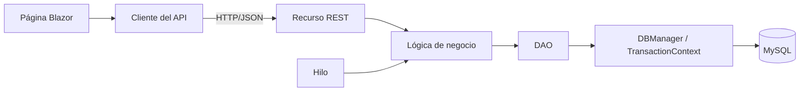

# Plan de implementación — BookShop

**Para:** el agente (Claude Code) que implementará BookShop.
**Qué es este documento:** la guía de **cómo** construir la aplicación. Reúne los documentos de referencia, el alcance buscado, las tecnologías, las convenciones del curso, la metodología, los incrementos y el procedimiento de trabajo.
**Qué no es:** una especificación. No define el esquema, las clases, los endpoints ni las reglas una por una. Eso lo decides tú a partir del ERS, del UX-UI y del prototipo, con los criterios de este plan.

---

## 1. Documentos de referencia

| Documento | Qué contiene | Cómo usarlo |
|---|---|---|
| `docs/ERS.md` | **Qué** hace la aplicación: actores, modelo de datos, estados, definiciones, parámetros, los 19 requisitos (RF01–RF19), las reglas de negocio (RN01–RN14) y las decisiones de interpretación. | Es la fuente de las capacidades y las reglas. Lo que dice se implementa; lo que no dice, no se agrega. Las definiciones de su §2.3 (precio final, venta válida, período, vista de resultados) y sus estados (§2.2) se respetan tal cual. |
| `docs/UX-UI.md` | **Cómo se ve y cómo se usa**: mapa de pantallas y rutas, navegación por rol, flujos, sistema visual, componentes, comportamientos comunes, cada pantalla, los PDF, todos los textos y la accesibilidad. | Es la fuente del front y del contenido de los PDF. Los textos de su §12 se usan literalmente. Su §14 indica cómo llevarlo a Blazor. |
| `docs/ui/` (prototipo) | 38 pantallas HTML navegables, con `theme.css` (el CSS definitivo de la aplicación), `mock.js` (el comportamiento simulado de los componentes) e `img/` (imágenes de ejemplo). | Es la base del **marcado**: cada pantalla Blazor parte del HTML de su archivo. Lo que `mock.js` genera (encabezado, menús, tarjetas, vista de resultados, filtros, diálogos, avisos, barra de comparación) muestra cómo debe comportarse cada componente. Se entra por `index.html`. |

**Prioridad ante una contradicción:** el ERS manda en funcionalidad y reglas; el UX-UI y el prototipo, en presentación e interacción; este plan, en tecnología, convenciones y forma de trabajo. Si la contradicción no se resuelve así, se pregunta al usuario.

**Lectura obligatoria antes de empezar:** el ERS completo, el UX-UI completo, `theme.css`, `mock.js` y las pantallas del prototipo de cada incremento. No se implementa nada sin haber leído su parte de los tres documentos.

---

## 2. Alcance y criterios

### 2.1 Qué se busca

Una aplicación **funcional para una demostración académica**, que un principiante pueda leer, seguir y explicar.

- **Todo lo documentado, nada más.** Se implementan todas las capacidades del ERS y todo el diseño del UX-UI y del prototipo. No se agregan funcionalidades, pantallas, campos ni reglas que los documentos no piden. Tampoco se quita ni se simplifica nada de lo que piden.
- **Solo escritorio.** Ancho mínimo de 1200 px (UX-UI §1). No hay versión para tableta ni móvil.
- **El flujo normal.** Cada capacidad se programa para el uso normal que describen los documentos (ERS §1.2: *"solo el flujo normal, sin casos excepcionales ni mecanismos de robustez"*).
- **Backend simple, front bien hecho.** La simplicidad se exige sobre todo en el backend. El front, en cambio, debe ser elaborado y decente (sección 2.5).
- **La lógica en el backend.** Reglas, cálculos, filtros, orden, paginación, recomendaciones e importes los resuelve el backend. El front presenta, captura y llama al API.

### 2.2 Validaciones: solo las mínimas

Los agentes tienden a **sobrevalidar**: agregan comprobaciones "por si acaso" que nadie pidió. Eso sale del alcance, llena el código de ramas que nunca se ejecutan en la demostración y lo vuelve difícil de leer. Aquí **no se hace**.

Una validación se escribe **solo** si cumple al menos una de estas dos condiciones:

1. **La pide un documento.** Por ejemplo, una regla del ERS (RN01–RN14), una condición de un RF (*"solo se cancela un pedido en almacén"*) o un error con texto propio en el UX-UI §12.2.
2. **Sin ella, el flujo normal deja datos incorrectos.** Por ejemplo, dos clientes que compran a la vez el último ejemplar (sección 2.3).

Todo lo demás **no se valida**. Algunos ejemplos de lo que no se escribe:
- volver a comprobar en el backend lo que el formulario ya restringe (campos vacíos, formatos, longitudes, rangos);
- comprobar que un id recibido exista, que un registro siga ahí o que un valor no sea nulo;
- comprobar estados "imposibles" o combinaciones que la interfaz no permite producir;
- comprobar el rol o el dueño de un registro en el backend (sección 2.4).

Antes de escribir una validación, pregúntate: *¿qué documento la pide, o qué dato queda mal en un uso normal si no la escribo?* Si no hay respuesta, no va.

### 2.3 Concurrencia: solo lo que ocurre en el uso normal

La concurrencia es tema del curso y sí se contempla, pero con el mismo criterio que las validaciones. Se protege solo lo que **ocurre de forma tangible** cuando varios usuarios usan la aplicación a la vez como dicen los documentos.

- **Sí es uso normal:** dos clientes que pagan al mismo tiempo libros cuyo stock no alcanza para ambos. Varias personas compran a la vez en cualquier tienda.
- **No es uso normal:** coincidencias rebuscadas que requieren un orden de eventos casi imposible de producir en una demostración. Por ejemplo, que el hilo de seguimiento cambie un pedido en el mismo instante en que el cliente lo cancela, o el mismo usuario enviando la misma operación desde dos pestañas.

Identificar los casos que sí corresponden es tu trabajo; el ejemplo de arriba no es la lista completa. Para cada uno eliges el mecanismo más simple que lo resuelva, entre los que se ven en el curso. Por ejemplo:
- monitores en el backend (`synchronized`, y `wait` / `notifyAll` si hace falta esperar);
- una transacción que lee con bloqueo (`select … for update`) antes de escribir;
- una escritura condicional (`update … where stock >= ?`).

Una vez elegido el mecanismo, se usa de la misma forma en todos los casos parecidos.

### 2.4 Seguridad

- **Lo que piden los documentos se implementa:**
  - inicio de sesión con contraseña, reactivación con contraseña y cambio de contraseña con la actual;
  - navegación y pantallas según el rol (UX-UI §3.2–3.4).
- **Contraseñas:** se guardan con un *hash* básico (SHA-256 con `MessageDigest`) y al iniciar sesión se compara el *hash*. No se usan librerías de seguridad.
- **Lo que no piden queda fuera:**
  - comprobar en el backend que quien llama a una operación inició sesión o tiene el rol correcto: en la aplicación solo se llega a esas acciones desde pantallas protegidas por rol, y llamar al API directamente queda fuera del alcance;
  - CSRF propio, CORS, sanitización de HTML, *rate limiting*, HTTPS en el servidor de aplicaciones.
- **Siempre:** consultas con `PreparedStatement`, que es la forma normal de JDBC.

### 2.5 Front: elaborado y bien hecho

El front debe ser **decente y pulido**, pero no a cualquier costo:

- **La base es siempre la del curso:** su metodología, sus convenciones, su organización del proyecto y su estilo de programación en Blazor (sección 3.4). Todo se construye sobre eso.
- **Sobre esa base, se puede elaborar más:** lo que haga falta para que el diseño del prototipo luzca y funcione bien en el uso real. No basta con que la pantalla se vea igual: cada interacción debe sentirse terminada y comportarse como espera el usuario.
- **Lo elaborado sigue siendo legible:** la sección 2.6 vale también para el front.

Base mínima para **toda** pantalla y componente (si una pantalla necesita más para quedar bien, también se hace):

| Aspecto | Qué tiene que cumplirse |
|---|---|
| Fidelidad | Marcado, clases, textos, iconos, espaciados y orden de bloques como en el prototipo. Textos literales del UX-UI §12. |
| Estados | Carga (`placeholder-glow` con la forma del contenido), contenido, vacío (UX-UI §12.3) y error. Nada queda en blanco ni salta al llegar los datos. |
| Comportamientos comunes | Todos los de UX-UI §7: aviso tras cada acción, confirmación de lo irreversible, botones deshabilitados con su explicación, consulta y edición en la misma pantalla… |
| Envíos | Todo botón que llama al API entra en estado *procesando* (UX-UI §6.1) y no admite un segundo clic hasta que responde. |
| Errores | Los mensajes de regla aparecen donde indica el UX-UI, con el foco en el primer campo con error. Un fallo inesperado del servidor muestra un aviso y no rompe la página. |
| Teclado y foco | Todo es operable con teclado; los diálogos atrapan el foco y lo devuelven; `Esc` cierra. Ninguna tecla navega, envía o borra sin querer (por ejemplo, `Enter` en un campo no debe enviar otro formulario). |
| Navegación | Búsqueda, filtros, orden, página y pestañas en la URL: *Atrás*, *Adelante* y los enlaces copiados restauran el estado. Título de la pestaña del navegador por página. |
| Estado de la sesión | El carrito y la comparación viven en la sesión del usuario (ERS §2.1). Recargar la página o abrir otra pestaña **no** los pierde; se pierden al cerrar la sesión. |
| Datos actualizados | Lo que una acción cambia se refleja en todo lo visible (contador del carrito, barra de comparación, nombre del encabezado, totales, filas) sin recargar la página. |
| Accesibilidad | Todo UX-UI §13. |

### 2.6 Legibilidad: sin fragmentación innecesaria

El código debe poder leerse **de arriba abajo**: cada operación, completa, en su método. Un principiante tiene que poder seguir una funcionalidad desde la página hasta el SQL sin saltar de método en método.

- **Lo normal:** las validaciones que correspondan (sección 2.2), los cálculos y los pasos van **dentro del método principal**, en el punto del flujo donde se necesitan.
- **Lo excepcional:** un método privado o una clase auxiliar. Se acepta solo si se reutiliza de verdad, reduce bastante código repetido y su contenido es simple de entender. Por ejemplo: el `hash` de la contraseña, usado en varias operaciones, o el armado de un objeto desde un `ResultSet` que comparten varias consultas.
- **Se evita a toda costa:**
  - métodos que agrupan validaciones (`validarPedido`, `verificarDatos`), aunque se reutilicen: esconden qué se valida, dificultan la lectura y suelen arrastrar validaciones fuera del alcance;
  - métodos de dos o tres líneas que se llaman una sola vez;
  - clases "helper", "util", "manager" o "service" que solo reenvían llamadas;
  - capas, interfaces, jerarquías o patrones que la arquitectura del curso no pide (*factories*, *builders*, *strategies*, genéricos propios);
  - expresiones elaboradas (`Stream`, `Optional`, referencias a métodos, ternarios anidados, expresiones regulares, reflexión). Se prefieren `for` e `if` con nombres claros.

  Estos son ejemplos; el criterio es siempre el mismo: si una extracción obliga a saltar para entender el flujo y no ahorra mucho, no se hace.
- **Comentarios:** cortos, solo para citar la regla (`// RN07`) o explicar una fórmula del ERS.

### 2.7 Infraestructura y rendimiento

- **Los volúmenes son de demostración** (decenas de libros y pedidos). No se agregan cachés, índices ni optimizaciones de entrada.
- **Excepción:** si algo responde lento de forma notoria (por ejemplo, abrir una conexión por consulta contra la base de datos de AWS), se puede aplicar una mejora simple y fácil de entender, como un *pool* de conexiones o evitar una consulta por fila. Se consulta antes al usuario y se anota en la sección 7.
- **Herramientas que no se usan:** pruebas automatizadas, Swagger, frameworks de *logging*, CI. Docker solo si hace falta para desplegar.

---

## 3. Tecnologías y arquitectura

### 3.1 Tecnologías

| Pieza | Tecnología |
|---|---|
| Back-end | Java 25, Maven multimódulo, arquitectura en capas |
| Acceso a datos | JDBC (`mysql-connector-j`) |
| Base de datos | MySQL en AWS RDS |
| Servicios web | REST con Jakarta REST (JAX-RS) en GlassFish 8; JSON con JSON-B |
| Reportes PDF | JasperReports (comprobante RF17, reportes RF18 y RF19) |
| Concurrencia | `java.lang.Thread` para el hilo periódico (RF03) |
| Front-end | C# con Blazor Web App (.NET 10, interactividad de servidor), Bootstrap 5.3 y Bootstrap Icons; JavaScript solo donde Blazor no lo resuelve bien |
| Cliente REST | `HttpClient` con `Newtonsoft.Json` |
| Autenticación | *Cookie* de ASP.NET Core |
| Despliegue | Desarrollo: local y Render (backend y front). Presentación: AWS EC2. Base de datos: AWS RDS en ambos. |

**Prohibido:** Spring, JPA/Hibernate, CDI (`@Inject`), EJB, Lombok, MapStruct, librerías JavaScript adicionales.

### 3.2 Organización del proyecto

```
BookShop/
├── docs/          documentos de referencia y este plan
├── database/      scripts SQL: esquema y datos de prueba
├── backend/       proyecto Maven multimódulo
└── frontend/      solución .NET con el proyecto Blazor
```

**Backend:** se abre con IntelliJ IDEA. Es un proyecto Maven **multimódulo**, con un `pom.xml` padre (`groupId` `pe.edu.pucp.bookshop`), cinco módulos y paquetes bajo `pe.edu.pucp.bookshop`:

| Módulo | Contenido | Depende de |
|---|---|---|
| `bookshop-model` | Modelos (una clase por entidad del ERS), enumerados y DTO | nada |
| `bookshop-db-manager` | Conexión a la base de datos y contexto de transacción | conector MySQL |
| `bookshop-dao` | Interfaces DAO e implementaciones JDBC | `model`, `db-manager` |
| `bookshop-business-logic` | Lógica de negocio (interfaces e implementaciones), sus excepciones, la generación de los PDF (llenar y exportar las plantillas de Jasper) y el hilo periódico | `dao`, JasperReports |
| `bookshop-rs` | Módulo de servicios (WAR): recursos REST, que solo exponen la lógica de negocio por HTTP, y el *listener* de la aplicación web que arranca y detiene el hilo | `business-logic`, Jakarta EE (`provided`) |

Cada pieza va donde está su responsabilidad:
- generar un PDF es lógica de negocio: el BL arma los datos, llena la plantilla y devuelve los bytes, y el recurso REST solo los envía como `application/pdf`;
- el hilo solo llama a la lógica de negocio y vive con ella;
- el *listener* depende del servidor web, por eso está en `bookshop-rs`.

**Front:** se abre con Visual Studio. Es **un solo proyecto** web Blazor (no multimódulo), organizado así:
- `Models/`: las clases que reflejan los modelos y DTO del backend;
- `Security/`: autenticación;
- una carpeta para la utilidad HTTP que consume el API y otra para el estado compartido de la sesión (sección 3.4);
- `Components/Layout`, `Components/Shared` (componentes del UX-UI §6), `Components/Pages` y `Components/Security`;
- `wwwroot/`: `theme.css` copiado tal cual del prototipo, imágenes y el JavaScript propio.

Las carpetas internas y los nombres de clases los defines tú, siguiendo la sección 3.4.

### 3.3 Capas



| Capa | Hace | No hace |
|---|---|---|
| DAO | Lee y escribe con SQL lo que le pide el BL. | Lógica de negocio: las condiciones que salen de una regla (estados válidos, plazos, montos, fechas límite) le llegan como parámetro. |
| Lógica de negocio | Aplica las reglas del ERS, calcula, decide, orquesta transacciones y encapsula los errores. | SQL, HTTP. |
| Recurso REST | Recibe la petición, llama al BL y devuelve el resultado. | Lógica. |
| Front | Presenta, captura, navega y llama al API. | Lógica de negocio. |

### 3.4 Convenciones del curso

Los fragmentos de código son **ilustrativos**: muestran la forma, no el contenido que debes implementar.

**Nombres**
- **En español:** el dominio, los métodos y las variables.
- **En inglés:** los sufijos técnicos del curso (`DAO`, `DAOImpl`, `BL`, `BLImpl`, `RS`, `Exception`).
- **Base de datos:**
  - tablas en singular y `snake_case`;
  - claves `id_<tabla>` y foráneas `fid_<tabla>`;
  - booleanos `TINYINT(1)`;
  - enumerados como `VARCHAR` con el nombre del valor.
- **Modelos:** atributos privados, constructor vacío, *getters* y *setters*; el identificador se llama `id`.

**Conexión y transacción** (`bookshop-db-manager`)

`DBManager` es un *singleton* que carga el *driver*, lee `db.properties` (en `src/main/resources` del WAR; no se sube a git, se sube un ejemplo) y abre una conexión nueva en cada llamada:

```java
public class DBManager {

    private static DBManager instance;
    private String url;
    private final String user;
    private final String password;

    private DBManager() {
        Properties properties = new Properties();
        try {
            Class.forName("com.mysql.cj.jdbc.Driver");
            InputStream inputStream = getClass().getClassLoader().getResourceAsStream("db.properties");
            properties.load(inputStream);
        } catch (ClassNotFoundException | IOException ex) {
            throw new RuntimeException(ex);
        }
        String host = properties.getProperty("host");
        String port = properties.getProperty("port");
        String database = properties.getProperty("database");
        this.url = "jdbc:mysql://" + host + ":" + port + "/" + database;
        this.url += "?allowPublicKeyRetrieval=true&useSSL=false&sessionVariables=time_zone='-05:00'";
        this.user = properties.getProperty("user");
        this.password = properties.getProperty("password");
    }

    public static DBManager getInstance() {
        if (instance == null)
            instance = new DBManager();
        return instance;
    }

    public Connection getConnection() throws SQLException {
        return DriverManager.getConnection(url, user, password);
    }
}
```

Dos detalles de esta versión:
- **Zona horaria:** `time_zone='-05:00'` hace que `NOW()` y `CURDATE()` usen la hora de Perú, aunque el servidor de AWS esté en UTC.
- **Despliegue:** en el despliegue, los mismos datos pueden leerse de variables de entorno cuando existan.

`TransactionContext` guarda la conexión de la transacción en un `ThreadLocal`:

```java
public class TransactionContext {
    private static final ThreadLocal<Connection> conexionActual = new ThreadLocal<>();

    public static Connection getConnection() throws SQLException {
        Connection con = conexionActual.get();
        if (con == null) {
            con = DBManager.getInstance().getConnection();
            con.setAutoCommit(false);
            conexionActual.set(con);
        }
        return con;
    }
    public static void commit() throws SQLException { ... }
    public static void rollback() { ... }
    public static void close() { ...; conexionActual.remove(); }
}
```

**DAO**
- Hay una interfaz (`XxxDAO`) y una implementación (`XxxDAOImpl`), en los paquetes `dao` y `dao.impl`. La interfaz declara solo los métodos que se usan; no hay interfaces genéricas que obliguen a dejar métodos vacíos.
- Cada método arma **su propia** consulta con las columnas que necesita, con `try` con recursos y `PreparedStatement`. Los filtros opcionales se agregan a partir de `where 1 = 1`, y la paginación usa un método `contar…` y otro `listar…` con `limit ?, ?`.
- Los métodos declaran `throws SQLException`. Si no hay fila, `obtener…` devuelve `null`.
- Fechas con `java.time` (`LocalDate`, `LocalDateTime`), leídas con `rs.getObject(col, LocalDate.class)`. **No** se usa `java.util.Date`, porque su JSON no lo lee bien el front.
- Los métodos que participan en una transacción usan `TransactionContext.getConnection()` y **no** cierran la conexión.

```java
@Override
public List<Direccion> listarActivasPorUsuario(int idUsuario) throws SQLException {
    String sql = """
        select id_direccion, alias, direccion, distrito, ciudad, predeterminada
        from direccion
        where fid_usuario = ? and activa = 1
    """;
    List<Direccion> direcciones = new ArrayList<>();
    try (Connection con = DBManager.getInstance().getConnection();
         PreparedStatement pstm = con.prepareStatement(sql)) {
        pstm.setInt(1, idUsuario);
        try (ResultSet rs = pstm.executeQuery()) {
            while (rs.next()) {
                Direccion direccion = new Direccion();
                direccion.setId(rs.getInt("id_direccion"));
                ...
                direcciones.add(direccion);
            }
        }
    }
    return direcciones;
}
```

**Lógica de negocio**
- Hay una interfaz (`XxxBL`) y una implementación (`XxxBLImpl`), en los paquetes `bl` y `bl.impl`. Los recursos REST y el hilo usan la interfaz.
- Las dependencias son campos creados con `new`: `private DireccionDAO direccionDAO = new DireccionDAOImpl();`. Un BL puede usar otro BL si necesita su resultado.
- **Excepciones de negocio** (paquete `bl.exception`):
  - se definen las necesarias, una por **familia** de error que el usuario puede encontrar en el uso normal, todas hijas de una excepción base `BusinessLogicException`;
  - su mensaje es el texto que verá el usuario (UX-UI §12.2);
  - hay que identificar las importantes. Por ejemplo, credenciales incorrectas, cuenta desactivada, registro duplicado, stock insuficiente, operación no permitida por estado o límite, no encontrado y error de acceso a datos. Son ejemplos de familias, no una lista cerrada ni una por regla.
- **Encapsulación:** el BL captura la `SQLException` y la envuelve en una excepción de negocio; ninguna `SQLException` sale del BL.
- **Errores:** se comunican **siempre** con excepciones. Ningún método devuelve `null`, `false` o un valor especial para decir que algo salió mal. Un `boolean` vale solo cuando la pregunta es de sí o no (por ejemplo, si un cliente puede reseñar un libro).

```java
@Override
public Usuario login(String correo, String contrasena) throws BusinessLogicException {
    try {
        Usuario usuario = usuarioDAO.obtenerPorCorreo(correo);
        if (usuario == null || !usuario.getContrasena().equals(hash(contrasena))) {
            throw new CredencialesInvalidasException("Correo o contraseña incorrectos.");
        }
        if (!usuario.getActivo()) {
            throw new CuentaDesactivadaException("Tu cuenta está desactivada.");
        }
        usuario.setContrasena(null);
        return usuario;
    } catch (SQLException ex) {
        throw new PersistenciaException(ex);
    }
}
```

**Transacción.** Se usa en cada operación que hace varias escrituras que deben quedar completas juntas, como el registro del pedido (RN12), o que debe proteger un caso de concurrencia (sección 2.3). Su forma es esta:

```java
try {
    // lecturas con bloqueo, validaciones y escrituras con la conexión de TransactionContext
    TransactionContext.commit();
} catch (SQLException ex) {
    TransactionContext.rollback();
    throw new PersistenciaException(ex);
} catch (BusinessLogicException ex) {
    TransactionContext.rollback();
    throw ex;
} finally {
    TransactionContext.close();
}
```

**Recurso REST** (`bookshop-rs`)
- Clases `XxxRS` con `@Path`, `@Produces("application/json")` y `@Consumes("application/json")`, bajo `@ApplicationPath("services")`. Cada método llama al BL y declara `throws BusinessLogicException`.
- Un `@Provider` (`ExceptionMapper`) traduce cada excepción de negocio a su código HTTP, con el mensaje en texto plano. El front muestra ese mensaje.

**Modelos y DTO**
- Los modelos reflejan las entidades del ERS §2.1. Las referencias a otra entidad son **objetos** (`Direccion.usuario`, `Libro.autor`), que pueden venir parciales (solo los campos que la pantalla usa). Un hijo no guarda a su padre, para evitar ciclos en el JSON.
- Los DTO se crean solo cuando una pantalla o una operación necesita datos que no son de un modelo: un resultado paginado, un resumen, credenciales, filas de un reporte. Son `record` si solo llevan datos.

**Hilo** (RF03).
- Es una clase de `bookshop-business-logic` que extiende `Thread`, con un bucle que llama a la lógica de negocio y luego espera con `Thread.sleep(60000)`.
- Un error en una vuelta se imprime, y la vuelta siguiente lo vuelve a intentar.
- Lo arranca un `ServletContextListener` (`@WebListener`) de `bookshop-rs` al desplegar, y lo detiene al apagar.
- Hace **solo** lo que dice el ERS: avanzar el seguimiento y emitir cupones.

**Reportes PDF.**
- **Plantillas:** se diseñan en JasperSoft Studio (ERS §6), con el diseño del UX-UI §11, y se guardan compiladas (`.jasper`) en los recursos de `bookshop-business-logic`.
- **Generación:** el BL carga la plantilla con `JRLoader`, la llena con una colección de *beans* (`JRBeanCollectionDataSource`) y parámetros, y la exporta a PDF con `JasperExportManager`. Devuelve los bytes.
- **Envío:** el recurso REST los entrega como `application/pdf` con `Content-Disposition: inline`.
- **Fuentes:** las del diseño, como extensión de fuentes de JasperReports. Descargar los archivos de fuentes requiere la confirmación del usuario.

**Front (Blazor), como en el curso**
- **Proyecto:** Blazor Web App con interactividad de servidor, organizado como en la sección 3.2. `Program.cs` registra los componentes interactivos, la autenticación y el estado de la sesión.
- **Páginas y componentes:**
  - con *code-behind*: el marcado en `Xxx.razor` (con `@page`, `<PageTitle>` y `@attribute [Authorize(Roles = …)]`) y la lógica en `Xxx.razor.cs` (`partial class`), con las dependencias en `[Inject]`;
  - un componente sin lógica puede tener solo su `.razor`;
  - los datos se atan con `@bind` y los eventos con `@onclick` / `@onchange`;
  - los componentes reutilizables van en `Components/Shared`, con parámetros (`[Parameter]`) y `EventCallback`.
- **Acceso al API:**
  - **Las páginas llaman al API directamente** desde su *code-behind*. No se crean clases intermedias por entidad (por ejemplo, una interfaz y una implementación por área): cada método sería una línea que reenvía al API, lo que es fragmentación sin beneficio (sección 2.6).
  - **Llamadas HTTP:** se hacen mediante una utilidad genérica basada en `HttpClient` y Newtonsoft, `HttpClientUtils<T>`, con un método por verbo HTTP. Esa utilidad:
    - usa la URL del API de `appsettings.json`, reemplazable por una variable de entorno;
    - envía las propiedades JSON en *camelCase* y los enumerados como texto.
  - **Errores:** cuando el API responde con error, la utilidad lanza una excepción con el código y el mensaje del *mapper*.

```csharp
public class HttpClientUtils<T>
{
    private static readonly HttpClient http = new HttpClient();
    private static readonly JsonSerializerSettings opciones = new JsonSerializerSettings
    {
        ContractResolver = new CamelCasePropertyNamesContractResolver(),
        Converters = { new StringEnumConverter() }
    };

    public async Task<T?> Get(string url)
    {
        return await Leer(await http.GetAsync(url));
    }

    public async Task<T?> Post(string url, object datos)
    {
        string json = JsonConvert.SerializeObject(datos, opciones);
        return await Leer(await http.PostAsync(url, new StringContent(json, Encoding.UTF8, "application/json")));
    }
    // Put y Delete con la misma forma

    private async Task<T?> Leer(HttpResponseMessage respuesta)
    {
        string texto = await respuesta.Content.ReadAsStringAsync();
        if (!respuesta.IsSuccessStatusCode)
            throw new ApiException((int)respuesta.StatusCode, texto);
        if (texto == "") return default;
        return JsonConvert.DeserializeObject<T>(texto, opciones);
    }
}

// En el code-behind de la página
direcciones = await new HttpClientUtils<List<Direccion>>().Get($"{Configuracion.UrlApi}direcciones/usuario/{idUsuario}");
```
- **Autenticación** (en `Security/`):
  - `AuthExtensions.AddCookieAuth()` registra la *cookie*, la autorización y el estado de autenticación;
  - `AuthEndpoints` expone `/auth/login`, que recibe el formulario de inicio de sesión, firma la *cookie* con los *claims* (id, nombre, correo y rol) y redirige, y `/auth/logout`;
  - `Components/Security/RedirectToLogin` envía a `/login` a quien no tiene sesión;
  - el encabezado usa `<AuthorizeView>`.
- **Estado de la sesión:** carrito, comparación, avisos y datos del encabezado, en clases *scoped* que avisan de sus cambios a los componentes.
- **Estilos y JavaScript:**
  - `theme.css` del prototipo, sin cambios; lo que falte va en un CSS propio pequeño;
  - JavaScript propio solo donde Blazor no basta (abrir los diálogos de Bootstrap, enfocar un campo, abrir un PDF recibido…).

### 3.5 Despliegue

| Entorno | Uso |
|---|---|
| Local | GlassFish 8 local y `dotnet run`, contra la base de datos de AWS RDS. |
| Render | Desarrollo compartido: backend y front publicados (con Docker si Render lo requiere). |
| AWS EC2 | Presentación final. |

La configuración (credenciales de la base de datos, URL del API) llega por archivos no versionados o por variables de entorno, nunca escrita en el código. Si falta una cuenta, credenciales o una decisión de despliegue, se pregunta al usuario.

---

## 4. Metodología

- **Incrementos verticales.** Cada incremento atraviesa todas las capas (BD → DAO → BL → REST → pantallas) y termina en algo demostrable. Se implementan en orden, uno a la vez.
- **Diseño propio, a partir de los documentos.** El esquema de la base de datos, los modelos, los DTO, los endpoints, las excepciones y las validaciones los defines tú, con los criterios de la sección 2. Al empezar un incremento diseñas solo lo que ese incremento necesita, pensando en lo que vendrá para no tener que deshacerlo. Las decisiones importantes se anotan en la sección 7.
- **Un solo sistema coherente.** Al terminar cada incremento, el sistema completo debe quedar consistente: los nombres, los patrones, los mensajes y la estructura se ven como escritos de una vez. Si un incremento muestra que algo anterior estaba mal ubicado o mal nombrado, se **refactoriza** en ese momento; no se acumulan parches.
- **Datos de prueba.** Los scripts de `database/` crean el esquema y cargan datos de prueba coherentes desde el primer incremento:
  - usuarios de cada rol, con la contraseña guardada como *hash*;
  - autores, categorías y editoriales con las imágenes de `docs/ui/img/`;
  - libros variados;
  - la configuración inicial del ERS §3.1.

  Antes de las recomendaciones y los reportes se agrega un historial de pedidos y reseñas que haga visibles sus resultados.

---

## 5. Incrementos

Tres incrementos, de tamaño parecido y ordenados por dependencia. Cada uno indica sus capacidades y lo que hay que leer; **cómo** implementarlas lo decides tú.

| Inc. | Nombre | Requisitos |
|---|---|---|
| I1 | Base, tienda pública, cuentas y administración del catálogo | RF01, RF02 (sin cupones), RF04.1–6, RF04.10, RF05.1–2, RF07, RF08, RF09 (sin compra, listas ni reseñas) |
| I2 | Compra, pedidos y posventa | RF02.12, RF03, RF04.7, RF11, RF15, RF16, RF17 |
| I3 | Biblioteca, reseñas, recomendaciones y reportes | RF04.8–9, RF04.11, RF05.3–4, RF06, RF10, RF12, RF13, RF14, RF18, RF19 |

### I1 · Base, tienda pública, cuentas y administración del catálogo

**Capacidades**
- **Base:**
  - la estructura completa del backend y del front;
  - la conexión a la base de datos y el manejo de errores;
  - el despliegue de desarrollo;
  - los diseños de página (encabezado, pie, diseños de tienda, cuenta, autenticación y administración), con los menús completos aunque algunas opciones lleven a pantallas que aún no existen.
- **Tienda pública:**
  - el inicio, con la portada, *Novedades* y el bloque *Explorar*;
  - el catálogo, con la vista de resultados completa: búsqueda, filtros, chips, orden, período y paginación, todo resuelto en el backend;
  - la vista *Novedades → Ver todos*;
  - el detalle del libro (sin compra, listas ni reseñas) y la comparación de dos libros;
  - Explorar, y la página de cada autor, categoría y editorial.
- **Cuentas:**
  - registro, inicio de sesión (con reactivación) y cierre de sesión, con la navegación y las pantallas según el rol;
  - el perfil del cliente: datos, contraseña, desactivación, direcciones y métodos de pago.
- **Administración del catálogo:** libros con sus descuentos; autores, categorías y editoriales, con imágenes y activación; y la configuración.

**Leer**
- ERS: §1–3, RF01, RF02, RF04.1–6, RF04.10, RF05.1–2, RF07, RF08, RF09, RN01–RN06, RN13.
- UX-UI: §1–7, §8.1–8.9, §9.1, §9.9–9.11, §10.1–10.4, §10.7, §12–14.
- Prototipo: `index.html`, `inicio.html`, `catalogo.html`, `libro.html`, `comparar.html`, `explorar.html`, `entidad.html`, `recomendaciones.html`, `login.html`, `registro.html`, `cuenta-datos.html`, `cuenta-direcciones.html`, `cuenta-metodos.html`, `admin-libros.html`, `admin-libro.html`, `admin-autores.html`, `admin-categorias.html`, `admin-editoriales.html`, `admin-configuracion.html`, `theme.css` y `mock.js`.

**Demostrable**
- Navegar la tienda como visitante, filtrar el catálogo con la URL sincronizada y comparar dos libros.
- Registrarse, desactivar la cuenta y reactivarla.
- Gestionar direcciones y métodos de pago.
- Como administrador, registrar un libro con portada y descuento y verlo en la tienda.

### I2 · Compra, pedidos y posventa

**Capacidades**
- **Compra:**
  - el carrito de la sesión;
  - el resumen de compra (dirección, método de pago y cupón, con alta de dirección o método desde el mismo resumen);
  - la revalidación al pagar y el pago simulado;
  - el registro del pedido en una sola transacción, con las compras simultáneas resueltas (sección 2.3);
  - la confirmación y el comprobante en PDF.
- **Pedidos:** el historial con filtros y orden, y el detalle con su seguimiento.
- **Hilo:** avanza el seguimiento y emite los cupones.
- **Posventa:**
  - la cancelación, con su límite mensual;
  - las solicitudes de devolución: crear, editar y retirar (cliente), y aceptar o rechazar (administrador);
  - *Mis solicitudes* (pestaña de devoluciones) y *Mis cupones*.

**Leer**
- ERS: RF02.12, RF03, RF04.7, RF11, RF15, RF16, RF17, RN07–RN10, RN12, RN13, §3.2.
- UX-UI: §3.3, §4.1, §4.2, §6.13, §6.15–6.17, §6.19, §8.3 (cantidad y carrito), §8.10–8.12, §9.2–9.5, §10.5, §11.1.
- Prototipo: `libro.html`, `carrito.html`, `compra.html`, `confirmacion.html`, `comprobante.html`, `cuenta-pedidos.html`, `pedido.html` (y sus variantes), `cuenta-solicitudes.html`, `cuenta-cupones.html` y `admin-devoluciones.html`.

**Demostrable**
- Comprar con y sin cupón.
- Ver un pago rechazado y un cambio de precio detectado al pagar.
- Descargar el comprobante.
- Ver un pedido avanzar solo hasta *Entregado* y cancelar otro.
- Pedir una devolución y aceptarla como administrador.
- Recibir un cupón.

### I3 · Biblioteca, reseñas, recomendaciones y reportes

**Capacidades**
- **Biblioteca:**
  - deseados y favoritos, y la pantalla *Mis listas*;
  - seguir autores, categorías y editoriales, y la pantalla *Seguimientos*.
- **Reseñas:**
  - publicar, editar y eliminar; votos útiles; reportes, con su pestaña en *Mis solicitudes*; *Mis reseñas*;
  - moderación: reportes pendientes, y ocultar o mostrar reseñas desde el detalle.
- **Recomendaciones:** las cinco del ERS, con sus algoritmos:
  - *Más vendidos*, *Más populares* y *Para ti*, en el inicio;
  - *Similares*, en el detalle;
  - *Complementarios*, en el carrito;
  - con sus vistas *Ver todos* y el período según ERS §2.3.
- **Reportes:** los PDF de libros y de clientes.
- **Datos:** el historial de pedidos y reseñas para demostrar todo lo anterior.
- **Cierre:**
  - revisión completa del sistema contra el ERS (trazabilidad del UX-UI §15);
  - `README.md` con la instalación, el despliegue y los usuarios de prueba;
  - `docs/GUION-DEMO.md` con un recorrido de unos 15 minutos.

**Leer**
- ERS: §2.3, §4.5, RF04.8–9, RF04.11, RF05.3–4, RF06, RF10, RF12–RF14, RF18, RF19, RN11, RN14.
- UX-UI: §4.3, §4.4, §6.6, §8.1, §8.3 (botones, reseñas y similares), §8.6, §8.7, §8.10 (complementarios), §9.4, §9.6–9.8, §10.6, §10.8, §11.2, §11.3, §15.
- Prototipo: `libro.html` (y `?resena=propia`), `listas.html`, `cuenta-seguimientos.html`, `cuenta-resenas.html`, `cuenta-solicitudes.html?tipo=reportes`, `admin-reportes-resenas.html`, `entidad.html`, `inicio.html`, `recomendaciones.html`, `carrito.html`, `admin-reportes.html`, `reporte-libros.html` y `reporte-clientes.html`.

**Demostrable**
- Guardar libros en las listas y seguir una editorial.
- Reseñar un libro entregado, votar y reportar desde otra cuenta, y ocultar la reseña como administrador.
- Los cuatro estantes del inicio con libros, y recomendaciones coherentes con el historial.
- Los dos PDF, con totales correctos.

---

## 6. Procedimiento de cada incremento

### 6.1 Pasos

1. **Leer** las secciones del ERS y del UX-UI y las pantallas del prototipo que indica el incremento. Releer de este plan lo que aplique.
2. **Diseñar lo necesario:** qué tablas o columnas, qué métodos, qué endpoints, qué validaciones (sección 2.2) y qué excepciones. Comprobar que encaja con lo existente sin contradicciones.
3. **Implementar** de abajo hacia arriba: script SQL → modelo → DAO → BL → REST → componentes y pantallas.
4. **Verificar:**
   - compilar el backend (`mvn clean package`), desplegarlo en GlassFish y probar los endpoints nuevos con `curl`, incluidos los errores que el usuario puede ver;
   - compilar y ejecutar el front y recorrer las capacidades del incremento en el navegador, comparando cada pantalla con su archivo del prototipo y probando teclado, recarga y doble clic;
   - si algo no se pudo comprobar, se anota.
5. **Dejar el sistema coherente** (sección 6.2) y refactorizar lo que haga falta.
6. **Registrar** en la sección 7 lo hecho, lo pendiente y las decisiones tomadas, y hacer un commit con el número y el nombre del incremento.

### 6.2 Buenas prácticas al cerrar un incremento

- **Sin contradicciones:** nada contradice al ERS, al UX-UI ni a lo hecho en incrementos anteriores.
- **Cada cosa en su lugar:** la lógica en el BL, el SQL en el DAO, la presentación en el front. Si algo quedó en la capa equivocada, se mueve.
- **Sin piezas sueltas:** no hay código muerto, métodos o componentes sin usar, `import`/`using` sobrantes, comentarios viejos, archivos temporales ni código adelantado de incrementos posteriores.
- **Consistencia:** el mismo problema se resuelve de la misma forma en toda la aplicación (manejo de errores, paginación, diálogos, avisos, nombres). Si en este incremento se encontró una forma mejor, se aplica también a lo anterior.
- **Refactorizar está permitido y se espera:** si un incremento revela que un diseño anterior no sirve, se corrige en ese momento, de forma completa, aunque toque código ya terminado.
- **Revisión con la sección 2:**
  - ¿hay validaciones que ningún documento pide?
  - ¿hay métodos o clases que solo fragmentan?
  - ¿hay lógica en el DAO o en el front?
  - ¿algún error se comunica con `null`?
  - ¿el front cumple la sección 2.5?
- **Legibilidad:** un principiante puede seguir cada funcionalidad nueva desde la pantalla hasta el SQL.

### 6.3 Cuándo preguntar al usuario

- Faltan herramientas, credenciales, cuentas (AWS, Render) o hay que descargar algo.
- El ERS, el UX-UI y el prototipo no resuelven una duda de funcionamiento o se contradicen entre sí.
- Se quiere aplicar una mejora de infraestructura o rendimiento (sección 2.7).
- Una decisión cambiaría algo ya entregado de forma visible para el usuario.

No se pregunta por decisiones de implementación que este plan deja en tus manos: se toman con sus criterios y se anotan.

---

## 7. Registro de avance

El agente actualiza esta sección al cerrar cada incremento.

| Inc. | Estado | Fecha | Verificado | Pendiente o no verificado |
|---|---|---|---|---|
| I1 | Terminado | 21/11/2026 | Con `curl`: catálogo con filtros combinados, orden y página; novedades; libros de una entidad; 401, 403 y 404; estados de los descuentos; configuración. En el navegador (1280 px): inicio, catálogo con la URL sincronizada y *Atrás*, detalle, comparación que sobrevive a la recarga, Explorar con búsqueda, página de entidad sin su propio filtro, inicio de sesión (datos incorrectos, cuenta desactivada y reactivación), registro (contraseñas distintas, correo repetido y sesión iniciada al terminar), perfil (edición con foco, contraseña actual incorrecta), direcciones (alta y predeterminada), métodos de pago (alta y número repetido), administración de libros (lista, consulta, edición, alta, descuento superpuesto y descuento nuevo), de autores (alta y desactivación) y de la configuración. Contraseñas guardadas como *hash* de 64 caracteres. | No se probaron en el navegador: subir imágenes (foto, portada, imagen de entidad) y el despliegue en Render. |
| I2 | Terminado | 21/11/2026 | Con `curl`: resumen (libros agotados fuera y cantidades limitadas al stock), pago con precio cambiado (412 con la lista de cambios), pago rechazado (402, sin registro), pago aprobado, comprobante PDF, cancelación (stock repuesto) y segunda cancelación (422), devolución fuera de plazo y con una pendiente (422), listados de pedidos, cupones y devoluciones. En el navegador (1280 px): agregar al carrito (visitante enviado a iniciar sesión), carrito, resumen de compra con y sin cupón (S/ 145.81, igual que el prototipo), datos cambiados al pagar, confirmación, comprobante desde el front, pedidos con filtro y orden en la URL, detalle con seguimiento, el hilo llevando un pedido a *En camino* y a *Entregado*, emisión de un cupón (con el plazo de devolución en 0 días por un momento), cancelación con su confirmación, solicitud de devolución, edición en *Mis solicitudes*, aceptación como administrador (pedido devuelto y stock repuesto), *Mis cupones* y estados vacíos. Scripts `01` y `02` probados sobre una base vacía. | No se vio en el navegador la alerta de pago rechazado (se probó con `curl`) ni se probó la imagen Docker ni el despliegue en Render. |
| I3 | Pendiente | | | |

**Decisiones de implementación** (fecha, incremento, decisión y motivo). Se anotan las que otro incremento necesita conocer: el esquema y sus cambios, las excepciones definidas, las convenciones de los endpoints, cómo se guarda el estado de la sesión, las mejoras de rendimiento aplicadas.

- **21/11/2026 · I1 · Esquema.** `database/01_esquema.sql` crea las tablas del I1: `usuario`, `direccion`, `metodo_pago`, `entidad`, `libro`, `descuento`, `resena` y `configuracion`. `resena` ya existe porque el detalle y la comparación muestran el promedio; sus pantallas llegan en el I3. Los incrementos siguientes agregan sus tablas al mismo script.
- **21/11/2026 · I1 · Autor, categoría y editorial en una sola tabla.** `entidad` con la columna `tipo` (`AUTOR`, `CATEGORIA`, `EDITORIAL`), una sola clase `Entidad` y un solo DAO, BL y RS (`entidades`). Tienen los mismos datos (la biografía del autor va en `descripcion`), y así Explorar, la página de entidad, Seguimientos y la administración son una página cada una. Los ids son únicos entre los tres tipos.
- **21/11/2026 · I1 · Excepciones de negocio.** Base `BusinessLogicException` (400) y las familias `CredencialesInvalidasException` (401), `CuentaDesactivadaException` (403), `NoEncontradoException` (404), `RegistroDuplicadoException` (409) y `PersistenciaException` (500, envuelve la `SQLException`). El *mapper* envía el mensaje como texto. Las familias de los incrementos siguientes (por ejemplo, stock insuficiente u operación no permitida) se agregan a este mismo esquema.
- **21/11/2026 · I1 · Vistas de libros.** `LibroBLImpl.filtrar` (privado) aplica a cualquier conjunto de libros la búsqueda, los filtros, el período por fecha de registro, el orden y la página (ERS §2.3, RF08) y devuelve el DTO `ResultadoLibros` con las opciones de los filtros. Los endpoints `libros`, `libros/novedades` y `libros/entidad/{id}` reciben los parámetros con el *bean* `ParametrosLibros`, con los mismos nombres que la URL del front. Las listas y las recomendaciones lo reutilizarán (las de ventas necesitarán que el período no se aplique a la fecha de registro).
- **21/11/2026 · I1 · Estado del descuento.** No es una columna: el BL lo calcula al listar con las fechas del ERS §2.3 (vigente, programado o finalizado). El precio final lo calcula `Libro.getPrecioFinal()` con el descuento vigente, que el DAO trae con la fecha que pasa el BL.
- **21/11/2026 · I1 · Estado de la sesión en el front.** La comparación se guarda en una *cookie* de sesión del navegador (`guardarSesion` / `leerSesion` de `app.js`): sobrevive a recargas y pestañas y se pierde al cerrar el navegador (ERS §2.1). El carrito del I2 usará el mismo mecanismo.
- **21/11/2026 · I1 · Inicio de sesión.** La página valida con el API (`usuarios/login`, 401 o 403) y, si es correcto, envía un formulario a `/auth/login`, que vuelve a validar con el backend y firma la *cookie*. La reactivación usa `PUT usuarios/reactivar` con las mismas credenciales.
- **21/11/2026 · I1 · Pool de conexiones (aprobado por el usuario).** `DBManager` usa HikariCP (10 conexiones). Abrir una conexión por consulta contra RDS tardaba cerca de 1 s; con el *pool*, las llamadas bajaron a 0.15–0.25 s. Si se recrea la base, hay que volver a desplegar el WAR para renovar las conexiones.
- **21/11/2026 · I1 · Herramientas locales.** GlassFish 8.0.5 en `C:\Users\Hrodic\tools\gf\glassfish8`; Maven 3.10.0 del caché del *wrapper*; JDK 25. Para el front: `dotnet run --project frontend/BookShopWeb --launch-profile http` (puerto 5245).
- **21/11/2026 · I1 · Estados vacíos sin texto en el UX-UI.** Direcciones, métodos de pago y la búsqueda sin resultados de Explorar no tienen texto de vacío en el UX-UI §12.3; se usaron textos breves en el mismo estilo.
- **21/11/2026 · I2 · Esquema.** Se agregan `cupon`, `pedido` (el número del pedido es su id y empieza en 1001), `detalle_pedido` (precio y descuento por unidad del momento de la compra) y `solicitud_devolucion`. `02_datos.sql` carga un historial de pedidos, cupones y devoluciones relativo a la fecha de carga (ver su comentario). En la base de RDS se aplicaron solo las tablas y filas nuevas, sin recrearla, para conservar las cuentas registradas.
- **21/11/2026 · I2 · Excepciones nuevas.** `OperacionNoPermitidaException` (422: estado o límite, como cancelar o devolver), `DatosCambiadosException` (412: al pagar cambió algo; el mensaje trae un cambio por línea) y `PagoRechazadoException` (402).
- **21/11/2026 · I2 · Compra.** El carrito vive en la *cookie* de sesión `bk-carrito` (`CarritoService`), que `/auth/logout` borra. Los importes los calcula siempre el backend con `POST pedidos/resumen` (carrito y resumen de compra); ese cálculo deja fuera los libros inactivos o agotados y limita cada cantidad a su stock, y el front deja el carrito como vuelve. `POST pedidos` recibe además el resumen que vio el cliente: en una transacción bloquea los libros (`select … for update`, la compra simultánea del último ejemplar), recalcula y compara (RF15.4), simula el pago y registra todo (RN12).
- **21/11/2026 · I2 · Listados de pedidos y solicitudes.** El DAO trae cada pedido con sus libros en una sola consulta (para `CoverStack` y las unidades) y el BL filtra, ordena y pagina en Java, igual que las vistas de libros. `GET pedidos/{id}` devuelve `PedidoDetalle`, con lo que decide las acciones (cancelaciones restantes y situación de la devolución); el BL lo reutiliza para validar RN07 y RN08.
- **21/11/2026 · I2 · Hilo.** `SeguimientoHilo` (en `bl.hilo`) llama cada minuto a `PedidoBL.avanzarSeguimiento()` y a `CuponBL.emitirCupones()`; lo arranca y detiene `SeguimientoListener` (`@WebListener`). Las fechas las genera Java, por eso el `Dockerfile` fija `TZ=America/Lima`.
- **21/11/2026 · I2 · PDF.** JasperReports 7.0.6 (`jasperreports`, `-pdf` y `-fonts`). La plantilla `reportes/comprobante.jrxml` se compila a `comprobante.jasper` para Java 11 (corre en el Java 21 de Render): en Jaspersoft Studio 7, o con `JasperCompileManager` y `jasperreports-jdt` pasando `-Dorg.eclipse.jdt.core.compiler.codegen.targetPlatform=11` (y `compliance` y `source`). Las fuentes Newsreader y Public Sans (Google Fonts, OFL) están en `resources/fuentes` como extensión de fuentes (`jasperreports_extension.properties`); los códigos usan DejaVu Sans Mono de `jasperreports-fonts`. El front entrega el PDF en `/comprobantes/{id}` (`DocumentosEndpoints`), que lo pide al API: así el botón es un enlace normal que abre una pestaña nueva. Los reportes del I3 pueden seguir el mismo camino.
- **21/11/2026 · I2 · Mis solicitudes.** La pestaña *Reportes de reseñas* ya existe y muestra su estado vacío; su contenido llega con las reseñas en el I3.
- **21/11/2026 · I2 · Memoria del backend en Render.** Con `-Xmx320m`, el proceso de GlassFish rondaba los 520 MB de los 512 MB del plan gratuito (al heap se suma la memoria propia de la JVM) y, al generar el primer PDF, Render lo reiniciaba. El `Dockerfile` usa ahora `-Xmx192m`, `-Xss512k`, `MaxMetaspaceSize=200m`, `ReservedCodeCacheSize=48m`, `TieredStopAtLevel=1`, `MaxDirectMemorySize=32m` y `UseSerialGC`: medido con GlassFish local tras cinco comprobantes, el proceso queda en unos 333 MB y el heap usado en unos 70 MB. GlassFish local quedó con las mismas opciones.
