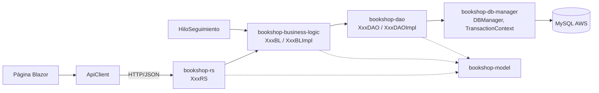

# Plan de implementación — BookShop

**Base:** `docs/ERS.md` · `docs/UX-UI.md` · prototipo `docs/ui/` · sílabo 1INF30 · repositorio del curso <https://github.com/jlcorcuera/pucp-progra3-2026-01>
**Para:** el agente (Claude Code) que implementará la aplicación en 8 incrementos verticales.

---

## 0. Cómo usar este documento

1. Este plan es la **fuente de verdad técnica**. El ERS dice *qué* hace la aplicación, el UX-UI y el prototipo dicen *cómo se ve y cómo se usa*, y este plan dice *cómo se construye*.
2. Las secciones 1 a 4 son **reglas y contratos fijos**: valen para todos los incrementos. La sección 5 describe cada incremento. La sección 6 es el procedimiento de trabajo. La sección 7 es el registro que el agente va llenando.
3. Se implementa **un incremento a la vez y en orden**. No se adelanta código de incrementos posteriores.
4. Antes de empezar un incremento se leen su ficha (sección 5), las secciones del ERS y del UX-UI que cita y los archivos del prototipo que indica.
5. Si algo no está resuelto aquí, ni en el ERS ni en el UX-UI, se pregunta al usuario. No se inventan funcionalidades ni se quitan.

---

## 1. Alcance y criterio de simplicidad

### 1.1 Qué se busca

Una aplicación **funcional para una demostración**, que un principiante pueda leer y explicar.

- Se implementan **todas** las capacidades del ERS (RF01–RF19, RN01–RN14) y **todo** el diseño del UX-UI y del prototipo: pantallas, componentes, textos, estados, comportamientos y accesibilidad. El diseño no se simplifica.
- La simplicidad está en la **implementación**: cada capacidad se programa en su forma más directa, cubriendo el flujo normal y las reglas que piden los documentos, y nada más.
- La lógica de negocio (reglas, cálculos, filtros, orden, paginación, recomendaciones, importes) vive en el **backend**. El front muestra datos, captura entradas y llama al API.
- El código se lee de arriba abajo: página → `ApiClient` → recurso REST → BL → DAO → SQL. Cada salto es una llamada directa.

### 1.2 Fuera de alcance

Lo siguiente **no** se implementa: son casos excepcionales o protecciones ajenas a lo que piden los documentos. Agregan código sin aportar a la demostración.

| Tema | Qué no se hace | Por qué basta |
|---|---|---|
| Autorización en el backend | Comprobar en el API que quien llama inició sesión, tiene el rol correcto o es dueño del registro (por ejemplo, que una operación de administrador la pida un administrador). | En la aplicación, a esas acciones solo se llega desde pantallas protegidas por rol en Blazor. Llamar al API directamente queda fuera del alcance. |
| Datos que el front ya controla | Volver a validar en el backend campos vacíos, formatos, longitudes o rangos que el formulario ya restringe. | El formulario es la única entrada de datos. |
| Existencia y coherencia | Comprobar que un id exista, que un registro no se haya borrado, nulos "por si acaso", estados imposibles. | El front solo envía ids que obtuvo del propio API. |
| Concurrencia | Bloqueos, control de versiones, dos usuarios comprando la última unidad al mismo tiempo, doble clic que envía dos veces. | La revalidación al pagar (RF15.4) cubre lo que pide el ERS. |
| Fallos de infraestructura | Reintentos, *timeouts* configurados, *pool* de conexiones, mensajes elaborados para errores de red o del servidor, recuperación del hilo. | Si el backend falla, se muestra el error genérico de Blazor (`#blazor-error-ui`). |
| Protección de la web | Sanitización de HTML, CSRF propio, CORS, HTTPS en GlassFish, *rate limiting*, expiración o renovación de sesiones más allá de la *cookie* del curso. | `PreparedStatement` siempre (es la forma normal de JDBC) y la *cookie* del curso. |
| Rendimiento | Cachés, índices adicionales, evitar consultas N+1, compilar los reportes en la construcción. | Los volúmenes son de demostración (decenas de libros y pedidos). |
| Herramientas | Pruebas automatizadas, módulo `test`, Swagger, *logging* con frameworks, Docker, CI. | Se verifica con `curl` y en el navegador (sección 6). |

**Contraseñas.** Se guardan con un *hash* SHA-256 en hexadecimal (`MessageDigest`, sin sal) y se comparan *hashes* al iniciar sesión, al reactivar y al cambiar la contraseña. Es el mínimo razonable, sin librerías.

### 1.3 Reglas de implementación

**Estructura (convenciones del curso)**

| Se hace | No se hace |
|---|---|
| Módulos Maven `model`, `db-manager`, `dao`, `business-logic` y un WAR de servicios REST, como `softprog`. | Frameworks extra: Spring, JPA/Hibernate, CDI (`@Inject`), EJB, Lombok, MapStruct. |
| DAO: interfaz `LibroDAO` + `LibroDAOImpl` (paquetes `dao` y `dao.impl`). | Interfaces DAO genéricas (`BaseDAO<T, ID>`) que obligan a dejar métodos vacíos: cada interfaz declara **solo** los métodos que se usan. |
| Lógica de negocio: interfaz `LibroBL` + `LibroBLImpl` (paquetes `bl` y `bl.impl`), como `CustomerBL` / `CustomerBLImpl`. | Lógica de negocio dentro de los recursos REST o de los DAO. |
| Dependencias como campos con `new`: `private LibroDAO libroDAO = new LibroDAOImpl();` y `private LibroBL libroBL = new LibroBLImpl();`. | Inyección de dependencias, *factories*, *singletons* propios (salvo `DBManager`, que es del curso). |
| Clases concretas sin interfaz solo para piezas que no son lógica de negocio: el hilo, su *listener* y el *mapper* de excepciones. | Clases "helper" o "util" en el backend; los cálculos van en el BL que los usa. |
| Clases de resultado del curso para listados paginados (`ResultadoPagina<T>`, como `PageResultDTO<T>` de `pokesoft`). | Capas de DTO que copian los modelos, clases "mapper". |
| Front: `Models/`, `Security/`, `Components/Layout`, `Components/Shared`, `Components/Pages`, como `SoftProg-WebApp`. | *Code-behind* (`.razor.cs`), CSS aislado (`.razor.css`), clases base de componentes. |
| Las páginas llaman a `ApiClient` directamente: `await Api.Get<Libro>($"libros/{Id}")`. | Servicios C# por entidad que solo envuelven al `ApiClient`. |

**Código Java y SQL**

| Se hace | No se hace |
|---|---|
| Bucles `for` e `if` con nombres claros. Lambdas solo como comparador de `sort`. | `Stream`, `Optional`, referencias a métodos, ternarios anidados, expresiones regulares, reflexión. |
| Los métodos declaran `throws SQLException` y la excepción sube hasta el recurso REST (el servidor responde 500). | `try/catch` en cada método para envolver la `SQLException`. |
| Una sola excepción de negocio, `BusinessLogicException` (del curso), cuyo mensaje es el texto que verá el usuario. | Jerarquías de excepciones. |
| Transacción solo en las tres operaciones de la sección 2.5.4. | Transacciones en operaciones de una sola sentencia. |
| Las constantes del ERS (20 %, 12, 8…) son `private static final` en la clase que las usa. | Clases de constantes o archivos de textos. |
| Un método por operación; un método privado solo si el mismo código se repite (por ejemplo, `mapear` en cada DAO). | Trocear un flujo en muchos métodos pequeños. |
| Comentarios cortos que citan la regla (`// RN07`) o explican una fórmula del ERS. | Javadoc en cada método o comentarios que repiten el código. |

**Front (C# / Blazor)**

| Se hace | No se hace |
|---|---|
| `<form @onsubmit>` con validación nativa de HTML (`required`, `pattern`, `min`, `max`) y el estilo `.is-invalid` de UX-UI §6.9 para los mensajes. | Validadores propios o lógica de negocio en C#. |
| LINQ simple (`Where`, `Select`, `Any`, `Count`) para presentar datos. | Filtrar, ordenar, paginar, calcular importes o aplicar reglas en el front: lo hace el backend. |
| JavaScript solo en `wwwroot/js/app.js` con las funciones de la sección 2.6, y `bootstrap.bundle` para menús y diálogos. | Más JavaScript propio o librerías JS. |
| `theme.css` del prototipo tal cual; si falta algo imprescindible, pocas líneas en `app.css`. | Rediseñar o cambiar estilos del prototipo. |
| Navegar con `<a href>` o `NavigationManager.NavigateTo`. Solo `/auth/login` y `/auth/logout` recargan la página. | Formularios HTML con `action` (salvo el de sesión) o `forceLoad` innecesarios: recargar reinicia el carrito. |
| `try/catch` solo donde el backend puede responder con un mensaje de regla (sección 4), para mostrarlo. | `try/catch` alrededor de cada llamada. |

**Nombres:** dominio, métodos y variables en español; sufijos técnicos del curso en inglés (`DAO`, `DAOImpl`, `BL`, `BLImpl`, `RS`).

---

## 2. Arquitectura

### 2.1 Tecnologías

| Pieza | Tecnología | Referencia del curso |
|---|---|---|
| Back-end | Java 25, Maven multimódulo | `unit-07.../softprog` |
| Acceso a datos | JDBC con `mysql-connector-j` 9.6.0 | `softprog-db-manager`, `softprog-dao` |
| Base de datos | MySQL en AWS RDS | `db.properties` del curso |
| Servicios web | Jakarta REST (JAX-RS) 4.0 en GlassFish 8; JSON con JSON-B (Yasson, incluido en GlassFish) | `softprog-rs`, `AlumnoRest`, `PokemonRS` |
| Reportes PDF | JasperReports 7.0.6 | `unit-08.../jasper-report-rest` |
| Hilo periódico | `java.lang.Thread` | `unit-09.../java` |
| Front-end | Blazor Web App .NET 10 con interactividad de servidor, Bootstrap 5.3.3, Bootstrap Icons 1.11.3 | `unit-06.../SoftProg-MasterDetail`, `unit-07.../SoftProg-WebApp` |
| Cliente REST | `HttpClient` + `Newtonsoft.Json` 13 | `unit-07.../CSharpRestClient` (`HttpClientUtils`) |
| Autenticación | *Cookie* con `AuthEndpoints` y `AuthorizeView` | `SoftProg-WebApp/Security` |

### 2.2 Estructura del repositorio

```
BookShop/
├── docs/                          ERS, UX-UI, prototipo, este plan
├── database/
│   ├── 01_esquema.sql             esquema completo (I1)
│   ├── 02_datos.sql               usuarios, catálogo, configuración (I1)
│   └── 03_historial.sql           pedidos y reseñas pasados (I8)
├── backend/                       proyecto Maven
│   ├── pom.xml                    padre (packaging pom)
│   ├── bookshop-model/            pe.edu.pucp.bookshop.model
│   ├── bookshop-db-manager/       pe.edu.pucp.bookshop.dbmanager
│   ├── bookshop-dao/              pe.edu.pucp.bookshop.dao  ·  .dao.impl
│   ├── bookshop-business-logic/   pe.edu.pucp.bookshop.bl  ·  .bl.impl  ·  .bl.exception
│   └── bookshop-rs/               WAR: pe.edu.pucp.bookshop.rs  ·  .hilo
│       └── src/main/resources/    db.properties, reportes/ (jrxml y extensión de fuentes)
├── frontend/
│   ├── BookShop.slnx
│   └── BookShopWeb/
│       ├── Program.cs · appsettings.json
│       ├── Models/                clases que reflejan los modelos Java + Enums.cs
│       ├── Security/              AuthEndpoints.cs, AuthExtensions.cs, Sesion.cs
│       ├── Servicios/             ApiClient, UsuarioActual, CarritoService, ComparacionService, AvisoService
│       ├── Utiles/                Formato.cs, Imagenes.cs, Entidades.cs
│       ├── Components/            App.razor, Routes.razor, _Imports.razor
│       │   ├── Layout/            MainLayout, AccountLayout, AuthLayout, AdminLayout
│       │   ├── Shared/            componentes de la sección 3.5
│       │   └── Pages/             Tienda/, Cuenta/, Admin/
│       └── wwwroot/               css/theme.css, css/app.css, js/app.js, img/
└── .gitignore                     target/, bin/, obj/, .idea/, db.properties, wwwroot/img/subidas/
```

### 2.3 Capas y dependencias



- Todos los módulos tienen como padre `backend/pom.xml` (`groupId` `pe.edu.pucp.bookshop`, versión `1.0.0-SNAPSHOT`, Java 25, UTF-8).
- `bookshop-model` depende de `jakarta.ws.rs-api` (`provided`) solo para las anotaciones `@QueryParam` de `FiltroLibros` y `FiltroLista` (sección 2.6).
- `bookshop-rs` es un WAR con `<finalName>bookshop</finalName>`; depende de `bookshop-business-logic` y de las API de Jakarta con `scope provided` (como `softprog-rs`).
- URL base del API: `http://localhost:8080/bookshop/services/` (`@ApplicationPath("services")`, como `jasper-report-rest`).

### 2.4 Convenciones de nombres

| Elemento | Convención | Ejemplo |
|---|---|---|
| Tabla | singular, `snake_case` | `detalle_pedido` |
| Clave primaria · foránea | `id_<tabla>` · `fid_<tabla>` | `id_pedido`, `fid_usuario` |
| Booleano · enumerado en BD | `TINYINT(1)` · `VARCHAR(20)` con el nombre del enumerado | `activo` · `'EN_ALMACEN'` |
| Modelo Java | atributos privados, constructor vacío, *getters* y *setters*; `Boolean` usa `getActivo()` | `Libro` |
| Identificador del modelo | `id` | `libro.getId()` |
| Referencia al usuario dueño | `idUsuario` (entero) | `Direccion.idUsuario` |
| Otra referencia | objeto (puede venir parcial) | `Libro.autor` |
| DAO | `LibroDAO` + `LibroDAOImpl` | |
| Lógica de negocio | `LibroBL` + `LibroBLImpl` | |
| Recurso REST | `LibroRS` con `@Path("libros")` | |
| Verbos de métodos | `listar…`, `obtener…`, `contar…`, `insertar`, `modificar`, `activar`, `desactivar`, `eliminar` (solo tablas fuera de RN03) y verbos del dominio (`cancelar`, `pagar`, `aceptar`) | `listarPorUsuario` |
| Ruta REST | sustantivo plural en minúsculas, con guion | `metodos-pago`, `reportes-resenas` |
| Página Razor | `PascalCase` en español | `PedidoDetalle.razor` |
| Componente compartido | nombre del UX-UI §6 | `BookCard.razor` |

### 2.5 Patrones de código de referencia

Todo el código sigue estos patrones, tomados de `softprog` y simplificados donde se indica.

#### 2.5.1 Conexión (`bookshop-db-manager`)

`DBManager` y `TransactionContext` se copian de `softprog` (paquete `pe.edu.pucp.bookshop.dbmanager`), con un único cambio en la URL para que `NOW()` y `CURDATE()` usen la hora de Perú aunque el servidor de AWS esté en UTC:

```java
this.url += "?allowPublicKeyRetrieval=true&useSSL=false&sessionVariables=time_zone='-05:00'";
```

`db.properties` va en `bookshop-rs/src/main/resources/` y no se sube a git; se sube `db.properties.ejemplo` con las mismas claves (`host`, `port`, `database`, `user`, `password`).

#### 2.5.2 DAO

Cada `XxxDAOImpl` tiene una constante `SELECT_BASE` con todas las columnas que lee su método `mapear`; cada consulta le agrega su `WHERE` y su `ORDER BY`. Los filtros opcionales siguen el estilo de `CustomerDAOImpl` del curso (`where 1 = 1` y se agregan condiciones).

```java
public class AutorDAOImpl implements AutorDAO {

    private static final String SELECT_BASE = """
        select a.id_autor, a.nombre, a.descripcion, a.imagen, a.activo,
               (select count(*) from libro l where l.fid_autor = a.id_autor) as cantidad_libros
        from autor a
        where 1 = 1
    """;

    @Override
    public List<Autor> listar(String texto, Boolean activo) throws SQLException {
        List<Autor> autores = new ArrayList<>();
        String sql = SELECT_BASE;
        if (texto != null && !texto.isEmpty()) {
            sql += " and a.nombre like concat('%', ?, '%')";
        }
        if (activo != null) {
            sql += " and a.activo = ?";
        }
        sql += " order by a.nombre";
        try (Connection con = DBManager.getInstance().getConnection();
             PreparedStatement pstm = con.prepareStatement(sql)) {
            int indice = 0;
            if (texto != null && !texto.isEmpty()) {
                pstm.setString(++indice, texto);
            }
            if (activo != null) {
                pstm.setBoolean(++indice, activo);
            }
            try (ResultSet rs = pstm.executeQuery()) {
                while (rs.next()) {
                    autores.add(mapear(rs));
                }
            }
        }
        return autores;
    }

    @Override
    public int insertar(Autor autor) throws SQLException {
        String sql = "insert into autor(nombre, descripcion, imagen, activo) values (?, ?, ?, ?)";
        try (Connection con = DBManager.getInstance().getConnection();
             PreparedStatement pstm = con.prepareStatement(sql, Statement.RETURN_GENERATED_KEYS)) {
            pstm.setString(1, autor.getNombre());
            pstm.setString(2, autor.getDescripcion());
            pstm.setString(3, autor.getImagen());
            pstm.setBoolean(4, autor.getActivo());
            pstm.executeUpdate();
            try (ResultSet rs = pstm.getGeneratedKeys()) {
                rs.next();
                return rs.getInt(1);
            }
        }
    }

    private Autor mapear(ResultSet rs) throws SQLException {
        Autor autor = new Autor();
        autor.setId(rs.getInt("id_autor"));
        autor.setNombre(rs.getString("nombre"));
        autor.setDescripcion(rs.getString("descripcion"));
        autor.setImagen(rs.getString("imagen"));
        autor.setActivo(rs.getBoolean("activo"));
        autor.setCantidadLibros(rs.getInt("cantidad_libros"));
        return autor;
    }
}
```

- Fechas: `rs.getObject("col", LocalDate.class)` / `LocalDateTime.class` y `pstm.setObject(i, valor)`.
- Enumerados: `EstadoPedido.valueOf(rs.getString("estado"))` y `pstm.setString(i, estado.name())`.
- Las fechas que se **guardan** se generan en Java (`LocalDate.now()`, `LocalDateTime.now().withNano(0)`). En las **consultas** se puede usar `CURDATE()`.
- Los métodos marcados **[T]** en las fichas participan en una transacción: toman la conexión con `TransactionContext.getConnection()` y **no** la cierran (como `SalesOrderDAOImpl.save` del curso).

#### 2.5.3 Lógica de negocio

```java
public interface UsuarioBL {
    Usuario registrar(Usuario usuario) throws SQLException, BusinessLogicException;
    Usuario login(String correo, String contrasena) throws SQLException;
}
```

```java
public class UsuarioBLImpl implements UsuarioBL {

    private UsuarioDAO usuarioDAO = new UsuarioDAOImpl();

    @Override
    public Usuario registrar(Usuario usuario) throws SQLException, BusinessLogicException {
        // RN01
        if (usuarioDAO.obtenerPorCorreo(usuario.getCorreo()) != null) {
            throw new BusinessLogicException("Ya existe una cuenta con este correo.");
        }
        if (usuario.getCorreo().endsWith("@admin.bookshop")) {
            usuario.setRol(Rol.ADMINISTRADOR);
        } else {
            usuario.setRol(Rol.CLIENTE);
        }
        usuario.setContrasena(hash(usuario.getContrasena()));
        usuario.setActivo(true);
        usuario.setFechaRegistro(LocalDateTime.now().withNano(0));
        usuario.setId(usuarioDAO.insertar(usuario));
        return usuario;
    }

    @Override
    public Usuario login(String correo, String contrasena) throws SQLException {
        Usuario usuario = usuarioDAO.obtenerPorCorreo(correo);
        if (usuario == null || !usuario.getContrasena().equals(hash(contrasena))) {
            return null;
        }
        return usuario;
    }

    // SHA-256 en hexadecimal
    private String hash(String texto) {
        try {
            MessageDigest digest = MessageDigest.getInstance("SHA-256");
            byte[] bytes = digest.digest(texto.getBytes(StandardCharsets.UTF_8));
            return HexFormat.of().formatHex(bytes);
        } catch (NoSuchAlgorithmException ex) {
            throw new RuntimeException(ex);
        }
    }
}
```

`BusinessLogicException` (paquete `pe.edu.pucp.bookshop.bl.exception`) es la del curso. Su mensaje es el texto exacto que verá el usuario (UX-UI §12.2).

#### 2.5.4 Transacción

Solo en **registrar pedido** (RN12), **cancelar pedido** y **aceptar devolución**, que cambian el pedido y el stock juntos. Patrón de `SalesOrderBLImpl`:

```java
try {
    pedidoDAO.marcarCancelado(idPedido, LocalDateTime.now().withNano(0));                 // [T]
    for (DetallePedido detalle : pedido.getDetalles()) {
        libroDAO.reponerStock(detalle.getLibro().getId(), detalle.getCantidad());          // [T]
    }
    TransactionContext.commit();
} catch (SQLException ex) {
    TransactionContext.rollback();
    throw ex;
} finally {
    TransactionContext.close();
}
```

Las lecturas y validaciones se hacen **antes** del `try`, con los métodos normales.

#### 2.5.5 Recurso REST

```java
@Path("direcciones")
@Produces("application/json")
@Consumes("application/json")
public class DireccionRS {

    private DireccionBL direccionBL = new DireccionBLImpl();

    @GET
    @Path("usuario/{idUsuario}")
    public List<Direccion> listarPorUsuario(@PathParam("idUsuario") int idUsuario) throws SQLException {
        return direccionBL.listarPorUsuario(idUsuario);
    }

    @POST
    public Direccion insertar(Direccion direccion) throws SQLException {
        return direccionBL.insertar(direccion);
    }

    @PUT
    @Path("{id}/desactivar")
    public void desactivar(@PathParam("id") int id) throws SQLException {
        direccionBL.desactivar(id);
    }
}
```

- Un método que devuelve `void` o `null` responde `204` sin cuerpo.
- Las fechas que llegan por *query string* son `String` (`"2026-11-20"`); el BL las convierte con `LocalDate.parse`.
- Un solo `@Provider` traduce la excepción de negocio a `400` con el mensaje en texto plano:

```java
@Provider
public class BusinessLogicExceptionMapper implements ExceptionMapper<BusinessLogicException> {
    @Override
    public Response toResponse(BusinessLogicException ex) {
        return Response.status(400).entity(ex.getMessage()).type("text/plain").build();
    }
}
```

#### 2.5.6 JSON entre Java y C#

| Java | MySQL | C# |
|---|---|---|
| `Integer` | `INT` | `int` (`int?` si puede faltar) |
| `Double` (importes) | `DECIMAL(10,2)` | `decimal` |
| `Double` (promedios, puntajes) | — | `double` |
| `String` | `VARCHAR` / `TEXT` | `string` con `= ""` (`string?` si es opcional) |
| `Boolean` | `TINYINT(1)` | `bool` |
| `LocalDate` | `DATE` | `DateOnly` (`DateOnly?` si es opcional) |
| `LocalDateTime` | `DATETIME` | `DateTime` (`DateTime?` si es opcional) |
| `enum` | `VARCHAR(20)` | `enum` con los **mismos** nombres (`EN_ALMACEN`) |
| `List<X>` | — | `List<X>` con `= new()` |

- **No** se usa `java.util.Date`: Yasson la serializa con la zona entre corchetes y Newtonsoft no la lee.
- Las propiedades C# van en `PascalCase` sin atributos: `ApiClient` usa `CamelCasePropertyNamesContractResolver` y `StringEnumConverter`.
- **Sin referencias circulares:** un hijo nunca guarda a su padre (`DetallePedido` no tiene `pedido`).
- Los objetos anidados pueden venir **parciales** (solo los campos que la pantalla usa); cada método DAO lo indica.
- Los cuerpos que no son modelos se envían como objeto anónimo en C#: `new { correo, contrasena }`.

#### 2.5.7 `ApiClient` (C#)

Es la versión con `HttpClient` del `HttpClientUtils` del curso (`HttpWebRequest` está obsoleto en .NET 10). Se registra como *singleton* en `Program.cs` con la URL de `appsettings.json` (`"ApiUrl": "http://localhost:8080/bookshop/services/"`).

```csharp
public class ApiClient
{
    private readonly HttpClient http;
    private readonly JsonSerializerSettings opciones = new()
    {
        ContractResolver = new CamelCasePropertyNamesContractResolver(),
        Converters = { new StringEnumConverter() }
    };

    public ApiClient(string urlBase)
    {
        http = new HttpClient { BaseAddress = new Uri(urlBase) };
    }

    public string Url(string ruta) => http.BaseAddress + ruta;

    public async Task<T?> Get<T>(string ruta) => await Leer<T>(await http.GetAsync(ruta));
    public async Task<byte[]> GetBytes(string ruta) => await http.GetByteArrayAsync(ruta);
    public async Task<T?> Post<T>(string ruta, object? datos = null) => await Leer<T>(await http.PostAsync(ruta, Cuerpo(datos)));
    public async Task<T?> Put<T>(string ruta, object? datos = null) => await Leer<T>(await http.PutAsync(ruta, Cuerpo(datos)));
    public async Task Post(string ruta, object? datos = null) => await Leer<object>(await http.PostAsync(ruta, Cuerpo(datos)));
    public async Task Put(string ruta, object? datos = null) => await Leer<object>(await http.PutAsync(ruta, Cuerpo(datos)));
    public async Task Delete(string ruta) => await Leer<object>(await http.DeleteAsync(ruta));

    private StringContent? Cuerpo(object? datos)
    {
        if (datos == null) return null;
        return new StringContent(JsonConvert.SerializeObject(datos, opciones), Encoding.UTF8, "application/json");
    }

    private async Task<T?> Leer<T>(HttpResponseMessage respuesta)
    {
        string texto = await respuesta.Content.ReadAsStringAsync();
        if (!respuesta.IsSuccessStatusCode)
        {
            throw new Exception(texto);   // en un 400, es el mensaje de la regla de negocio
        }
        if (texto == "") return default;
        return JsonConvert.DeserializeObject<T>(texto, opciones);
    }
}
```

#### 2.5.8 Página Blazor

```razor
@page "/cuenta/direcciones"
@layout AccountLayout
@attribute [Authorize(Roles = "CLIENTE")]
@inject ApiClient Api
@inject AvisoService Aviso

<h1>Direcciones</h1>
@if (direcciones == null)
{
    @* bloques placeholder-glow con la forma de las tarjetas (UX-UI §7) *@
}
else
{
    @foreach (Direccion direccion in direcciones) { ... }
}

<ConfirmModal @ref="confirmacion" Titulo="¿Eliminar esta dirección?"
              Mensaje="Dejará de ofrecerse al pagar. Los pedidos que la usaron la seguirán mostrando."
              TextoAccion="Sí, eliminar" Peligro="true" OnConfirmar="Eliminar" />

@code {
    [CascadingParameter] private Task<AuthenticationState> AuthState { get; set; } = default!;

    private int idUsuario;
    private List<Direccion>? direcciones;
    private Direccion? direccionAEliminar;
    private ConfirmModal confirmacion = default!;

    protected override async Task OnInitializedAsync()
    {
        idUsuario = Sesion.Id((await AuthState).User);
        direcciones = await Api.Get<List<Direccion>>($"direcciones/usuario/{idUsuario}");
    }

    private async Task PedirEliminar(Direccion direccion)
    {
        direccionAEliminar = direccion;
        await confirmacion.Mostrar();
    }

    private async Task Eliminar()
    {
        await Api.Put($"direcciones/{direccionAEliminar!.Id}/desactivar");
        direcciones!.Remove(direccionAEliminar);
        Aviso.Mostrar("Dirección eliminada");
    }
}
```

- **Marcado:** se toma del archivo del prototipo indicado en la ficha. Se copian las clases `bk-*`, las de Bootstrap y los atributos `aria-*`, y se reemplazan los datos de ejemplo por los reales. Lo que el prototipo genera con `mock.js` (encabezado, tarjetas, vista de resultados, diálogos…) se traduce leyendo su función (`header()`, `bookCard()`, `resultsView()`, `checkFilter()`, `confirmar()`…).
- **Diálogos:** son *modals* de Bootstrap con su marcado normal, siempre presentes en la página. Se abren y cierran con `abrirModal` / `cerrarModal` de `app.js`, así Bootstrap da el foco atrapado, `Esc` y el fondo (UX-UI §13). Los datos del diálogo se cargan en C# antes de abrirlo.
- **Carga:** mientras llegan los datos, cada pantalla muestra bloques `placeholder-glow` con la forma de su contenido (UX-UI §7).

### 2.6 Decisiones transversales

| Tema | Decisión |
|---|---|
| **Vistas de resultados de libros** | Toda la lógica está en el backend. Los endpoints que devuelven una vista de libros (catálogo, página de entidad, Mis listas, Novedades y recomendaciones) reciben los mismos parámetros, agrupados en `FiltroLibros` con `@BeanParam`: `q`, `categoria`, `autor` y `editorial` (repetibles), `idioma`, `min`, `max`, `desde`, `hasta`, `orden` (`titulo-asc`, `titulo-desc`, `precio-asc`, `precio-desc`), `pagina` y `tamano` (12 por defecto). Devuelven un `ResultadoLibros`. |
| **Cómo se filtra** | Cada endpoint arma primero su **conjunto** (los libros activos; los de una lista; o el resultado ordenado de una recomendación). Luego `LibroBLImpl.filtrar(conjunto, filtro, permiteOrden, periodoPorRegistro)` aplica la búsqueda, los filtros, el período por fecha de registro (si corresponde), el orden (si la vista lo permite), calcula las opciones de filtro y corta la página. Un solo método para todas las vistas: así los filtros funcionan igual en el catálogo y en las recomendaciones. Cuando el período delimita **ventas**, lo usa el algoritmo de la recomendación al armar el conjunto y `filtrar` no lo vuelve a aplicar. |
| **Opciones de los filtros** | `ResultadoLibros` trae las categorías, autores, editoriales e idiomas presentes en el conjunto (antes de filtrar), en orden alfabético, para que `CheckFilter` las muestre. |
| **Otros listados** | Explorar, Seguimientos, Pedidos y las tablas de administración filtran, ordenan y paginan en el SQL, al estilo de `CustomerDAOImpl` (`contar…` + `listar…` con `limit ?, ?`). El recurso devuelve un `ResultadoPagina<T>` (`total` y `elementos`), como el `PageResultDTO<T>` del laboratorio 11. Los parámetros llegan con `@BeanParam FiltroLista` (`q`, `estado`, `orden`, `pagina`, `tamano`). |
| **URL del front** | La búsqueda, los filtros, el orden y la página viajan en la URL (UX-UI §6.7). `ResultsView` lee la *query string* de la página, la reenvía tal cual al endpoint que recibe por parámetro (los nombres son los mismos) y, al cambiar un filtro, navega a la misma página con la nueva *query string*. Escucha `NavigationManager.LocationChanged` para recargar, así *Atrás* funciona. Lo mismo hacen Explorar, Seguimientos, Pedidos y las tablas de administración con sus parámetros. |
| **Interactividad** | `<Routes @rendermode="new InteractiveServerRenderMode(prerender: false)" />` y lo mismo en `<HeadOutlet>`: sin prerenderizado, cada `OnInitializedAsync` se ejecuta una sola vez. |
| **Autenticación** | *Cookie* del curso (`AuthExtensions`, `AuthEndpoints`). `/auth/login` recibe un formulario oculto que la página de inicio de sesión envía con `enviarFormulario` después de validar con el API (I3). *Claims*: `NameIdentifier` = id, `Name` = nombre, `Email` = correo, `Role` = `CLIENTE` o `ADMINISTRADOR`. `/auth/logout` cierra la sesión y recarga en `/`. Las páginas se protegen con `@attribute [Authorize(Roles = "...")]` y el encabezado con `<AuthorizeView>`. |
| **Usuario en las páginas** | `Sesion` (estática): `Id(user)`, `EsCliente(user)`, `EsAdmin(user)` e `IrALogin(nav)` (navega a `/login?volver={página actual}`). Las páginas leen el usuario con `[CascadingParameter] Task<AuthenticationState>`. |
| **Nombre y foto del encabezado** | `UsuarioActual` (*scoped*) guarda el `Usuario` que `MainLayout` y `AdminLayout` piden al API al iniciar. El perfil lo actualiza al guardar con `Actualizar(usuario)`, que dispara su evento `Cambio`. |
| **Estado de sesión** | `CarritoService`, `ComparacionService`, `AvisoService` y `UsuarioActual` son *scoped* (UX-UI §14.5). Cada uno expone `event Action? Cambio`, que los componentes atienden con `InvokeAsync(StateHasChanged)`. El carrito guarda **qué** libros y **cuántos**; los importes los calcula siempre el backend (`POST pedidos/preparar`). |
| **JavaScript** (`wwwroot/js/app.js`) | Solo estas funciones: `enviarFormulario(id)`, `abrirModal(id)` y `cerrarModal(id)` (`bootstrap.Modal.getOrCreateInstance`), `enfocar(selector)` (foco en el primer campo con error, UX-UI §6.9; foco en el primer campo al pasar a edición, UX-UI §7.1), `irArriba()` (al cambiar de página, UX-UI §6.7) y `abrirPdf(base64)` (crea un `Blob` y lo abre en una pestaña nueva; se usa para mostrar *"Generando…"*, UX-UI §10.8). |
| **PDF** | El recurso REST genera el PDF con `Content-Disposition: inline`. El comprobante se abre con un enlace `target="_blank"` a `Api.Url(...)`. Los reportes de administración se piden con `Api.GetBytes` mientras el botón muestra *"Generando…"* y luego se abren con `abrirPdf`. |
| **Fuentes del PDF** | Newsreader y Public Sans (UX-UI §11) como extensión de fuentes de JasperReports en `bookshop-rs/src/main/resources/` (`jasperreports_extension.properties`, `fonts/fonts.xml` y los TTF estáticos Regular y SemiBold de Google Fonts, licencia OFL). Descargar los TTF requiere confirmación del usuario. |
| **Imágenes** | En la BD se guarda la **ruta relativa** del archivo dentro de `wwwroot` del front (`img/autor/ines-valdivia.svg`). Las imágenes de ejemplo se copian de `docs/ui/img/`. Las subidas se guardan con `Imagenes.Guardar(archivo)` en `wwwroot/img/subidas/{Guid}{extensión}`. `Program.cs` llama a `app.UseStaticFiles()` además de `MapStaticAssets()`, porque `MapStaticAssets` solo sirve los archivos conocidos al compilar. Sin imagen se usa la portada tipográfica o las iniciales (UX-UI §5.8). |
| **Importes** | Todas las fórmulas de dinero están en Java (`PedidoBLImpl` y el `mapear` de `LibroDAOImpl`), redondeadas con `Math.round(valor * 100) / 100.0`. |
| **Estados** | `StatusBadge` recibe el nombre del estado y tiene la única tabla de estado → texto y clase (UX-UI §5.3). Los estados derivados (por ejemplo, *Vigente* de un descuento) los calcula el backend. |
| **Formato** | `Formato` (estática): `Soles(decimal)` → `S/ 1,234.50`; `Fecha` → `dd/mm/aaaa`; `FechaHora` → `dd/mm/aaaa hh:mm`; `Pedido(id)` → `N.º 1045`; `Enmascarar(numero)` → `**** **** **** 1234`; `Iniciales(nombre)`. |
| **Autor, categoría y editorial** | Tienen las mismas columnas (la biografía del autor va en `descripcion`). En el front se leen con una sola clase `Entidad`, y `Entidades` (estática) da, por `TipoEntidad`, la ruta del API (`autores`), el plural (`Autores`) y el singular (`autor`). Así Explorar, la página de entidad, Seguimientos y la administración son una página cada una. En Java siguen siendo tres clases con su DAO, BL y RS. |
| **Motivos** | Los motivos de devolución y de reporte se guardan como el texto que se muestra (`"Producto dañado"`). |
| **Números y códigos** | `pedido` empieza en `AUTO_INCREMENT = 1001`. Códigos `"TX-"`, `"SG-"` y `"CUP-"` seguidos de `UUID.randomUUID().toString().substring(0, 8).toUpperCase()`. |

---

## 3. Contratos compartidos

Se fijan en I1 y **no se cambian**: los incrementos solo agregan. Si un incremento necesita algo que no está aquí, el agente hace el cambio mínimo **aditivo** (un campo derivado, un método nuevo), actualiza esta sección y lo anota en la sección 7. Nunca renombra ni cambia firmas existentes.

### 3.1 Esquema de base de datos

`database/01_esquema.sql` contiene **todo** el esquema desde I1:

```sql
DROP DATABASE IF EXISTS bookshop;
CREATE DATABASE bookshop CHARACTER SET utf8mb4 COLLATE utf8mb4_spanish_ci;
USE bookshop;

CREATE TABLE usuario (
  id_usuario        INT AUTO_INCREMENT PRIMARY KEY,
  correo            VARCHAR(100) NOT NULL UNIQUE,
  nombre_completo   VARCHAR(100) NOT NULL,
  fecha_nacimiento  DATE NOT NULL,
  contrasena        CHAR(64) NOT NULL,
  foto              VARCHAR(200),
  rol               VARCHAR(20) NOT NULL,
  activo            TINYINT(1) NOT NULL DEFAULT 1,
  fecha_registro    DATETIME NOT NULL
);

CREATE TABLE direccion (
  id_direccion    INT AUTO_INCREMENT PRIMARY KEY,
  fid_usuario     INT NOT NULL,
  alias           VARCHAR(50) NOT NULL,
  direccion       VARCHAR(200) NOT NULL,
  distrito        VARCHAR(100) NOT NULL,
  ciudad          VARCHAR(100) NOT NULL,
  predeterminada  TINYINT(1) NOT NULL DEFAULT 0,
  activa          TINYINT(1) NOT NULL DEFAULT 1,
  FOREIGN KEY (fid_usuario) REFERENCES usuario(id_usuario)
);

CREATE TABLE metodo_pago (
  id_metodo_pago     INT AUTO_INCREMENT PRIMARY KEY,
  fid_usuario        INT NOT NULL,
  tipo               VARCHAR(20) NOT NULL,
  titular            VARCHAR(100) NOT NULL,
  numero             VARCHAR(16) NOT NULL,
  fecha_vencimiento  VARCHAR(5),
  proveedor          VARCHAR(20),
  predeterminado     TINYINT(1) NOT NULL DEFAULT 0,
  activo             TINYINT(1) NOT NULL DEFAULT 1,
  FOREIGN KEY (fid_usuario) REFERENCES usuario(id_usuario)
);

CREATE TABLE autor (
  id_autor     INT AUTO_INCREMENT PRIMARY KEY,
  nombre       VARCHAR(100) NOT NULL,
  descripcion  TEXT,
  imagen       VARCHAR(200),
  activo       TINYINT(1) NOT NULL DEFAULT 1
);

CREATE TABLE categoria (
  id_categoria  INT AUTO_INCREMENT PRIMARY KEY,
  nombre        VARCHAR(100) NOT NULL,
  descripcion   TEXT,
  imagen        VARCHAR(200),
  activo        TINYINT(1) NOT NULL DEFAULT 1
);

CREATE TABLE editorial (
  id_editorial  INT AUTO_INCREMENT PRIMARY KEY,
  nombre        VARCHAR(100) NOT NULL,
  descripcion   TEXT,
  imagen        VARCHAR(200),
  activo        TINYINT(1) NOT NULL DEFAULT 1
);

CREATE TABLE libro (
  id_libro          INT AUTO_INCREMENT PRIMARY KEY,
  isbn              VARCHAR(20) NOT NULL,
  titulo            VARCHAR(200) NOT NULL,
  sinopsis          TEXT,
  idioma            VARCHAR(30) NOT NULL,
  paginas           INT NOT NULL,
  anio_publicacion  INT NOT NULL,
  precio            DECIMAL(10,2) NOT NULL,
  stock             INT NOT NULL,
  portada           VARCHAR(200),
  activo            TINYINT(1) NOT NULL DEFAULT 1,
  fecha_registro    DATETIME NOT NULL,
  fid_autor         INT NOT NULL,
  fid_categoria     INT NOT NULL,
  fid_editorial     INT NOT NULL,
  FOREIGN KEY (fid_autor) REFERENCES autor(id_autor),
  FOREIGN KEY (fid_categoria) REFERENCES categoria(id_categoria),
  FOREIGN KEY (fid_editorial) REFERENCES editorial(id_editorial)
);

CREATE TABLE descuento (
  id_descuento  INT AUTO_INCREMENT PRIMARY KEY,
  fid_libro     INT NOT NULL,
  porcentaje    INT NOT NULL,
  fecha_inicio  DATE NOT NULL,
  fecha_fin     DATE NOT NULL,
  FOREIGN KEY (fid_libro) REFERENCES libro(id_libro)
);

CREATE TABLE cupon (
  id_cupon           INT AUTO_INCREMENT PRIMARY KEY,
  fid_usuario        INT NOT NULL,
  codigo             VARCHAR(20) NOT NULL UNIQUE,
  porcentaje         INT NOT NULL,
  fecha_emision      DATE NOT NULL,
  fecha_vencimiento  DATE NOT NULL,
  activo             TINYINT(1) NOT NULL DEFAULT 1,
  FOREIGN KEY (fid_usuario) REFERENCES usuario(id_usuario)
);

CREATE TABLE pedido (
  id_pedido           INT AUTO_INCREMENT PRIMARY KEY,
  fid_usuario         INT NOT NULL,
  fid_direccion       INT NOT NULL,
  fid_metodo_pago     INT NOT NULL,
  fid_cupon           INT,
  estado              VARCHAR(20) NOT NULL,
  fecha_compra        DATETIME NOT NULL,
  fecha_salida        DATETIME,
  fecha_entrega       DATETIME,
  fecha_cancelacion   DATETIME,
  fecha_devolucion    DATETIME,
  codigo_transaccion  VARCHAR(20) NOT NULL,
  codigo_seguimiento  VARCHAR(20) NOT NULL,
  subtotal            DECIMAL(10,2) NOT NULL,
  descuento_cupon     DECIMAL(10,2) NOT NULL,
  costo_envio         DECIMAL(10,2) NOT NULL,
  total               DECIMAL(10,2) NOT NULL,
  contado_para_cupon  TINYINT(1) NOT NULL DEFAULT 0,
  FOREIGN KEY (fid_usuario) REFERENCES usuario(id_usuario),
  FOREIGN KEY (fid_direccion) REFERENCES direccion(id_direccion),
  FOREIGN KEY (fid_metodo_pago) REFERENCES metodo_pago(id_metodo_pago),
  FOREIGN KEY (fid_cupon) REFERENCES cupon(id_cupon)
) AUTO_INCREMENT = 1001;

CREATE TABLE detalle_pedido (
  id_detalle_pedido   INT AUTO_INCREMENT PRIMARY KEY,
  fid_pedido          INT NOT NULL,
  fid_libro           INT NOT NULL,
  cantidad            INT NOT NULL,
  precio_unitario     DECIMAL(10,2) NOT NULL,
  descuento_unitario  DECIMAL(10,2) NOT NULL,
  subtotal            DECIMAL(10,2) NOT NULL,
  FOREIGN KEY (fid_pedido) REFERENCES pedido(id_pedido),
  FOREIGN KEY (fid_libro) REFERENCES libro(id_libro)
);

CREATE TABLE solicitud_devolucion (
  id_solicitud_devolucion  INT AUTO_INCREMENT PRIMARY KEY,
  fid_pedido               INT NOT NULL,
  motivo                   VARCHAR(50) NOT NULL,
  comentario               VARCHAR(500) NOT NULL,
  estado                   VARCHAR(20) NOT NULL,
  fecha                    DATETIME NOT NULL,
  FOREIGN KEY (fid_pedido) REFERENCES pedido(id_pedido)
);

CREATE TABLE resena (
  id_resena    INT AUTO_INCREMENT PRIMARY KEY,
  fid_usuario  INT NOT NULL,
  fid_libro    INT NOT NULL,
  puntuacion   INT NOT NULL,
  comentario   TEXT NOT NULL,
  fecha        DATETIME NOT NULL,
  activa       TINYINT(1) NOT NULL DEFAULT 1,
  UNIQUE (fid_usuario, fid_libro),
  FOREIGN KEY (fid_usuario) REFERENCES usuario(id_usuario),
  FOREIGN KEY (fid_libro) REFERENCES libro(id_libro)
);

CREATE TABLE voto_util (
  fid_usuario  INT NOT NULL,
  fid_resena   INT NOT NULL,
  PRIMARY KEY (fid_usuario, fid_resena),
  FOREIGN KEY (fid_usuario) REFERENCES usuario(id_usuario),
  FOREIGN KEY (fid_resena) REFERENCES resena(id_resena) ON DELETE CASCADE
);

CREATE TABLE reporte_resena (
  id_reporte_resena     INT AUTO_INCREMENT PRIMARY KEY,
  fid_usuario           INT NOT NULL,
  fid_resena            INT NOT NULL,
  motivo                VARCHAR(50) NOT NULL,
  comentario            VARCHAR(500) NOT NULL,
  contenido_reportado   TEXT NOT NULL,
  puntuacion_reportada  INT NOT NULL,
  estado                VARCHAR(20) NOT NULL,
  fecha                 DATETIME NOT NULL,
  FOREIGN KEY (fid_usuario) REFERENCES usuario(id_usuario),
  FOREIGN KEY (fid_resena) REFERENCES resena(id_resena) ON DELETE CASCADE
);

CREATE TABLE seguimiento_entidad (
  fid_usuario  INT NOT NULL,
  tipo         VARCHAR(20) NOT NULL,
  id_entidad   INT NOT NULL,
  fecha        DATETIME NOT NULL,
  PRIMARY KEY (fid_usuario, tipo, id_entidad),
  FOREIGN KEY (fid_usuario) REFERENCES usuario(id_usuario)
);

CREATE TABLE lista_libro (
  fid_usuario  INT NOT NULL,
  fid_libro    INT NOT NULL,
  lista        VARCHAR(20) NOT NULL,
  PRIMARY KEY (fid_usuario, fid_libro, lista),
  FOREIGN KEY (fid_usuario) REFERENCES usuario(id_usuario),
  FOREIGN KEY (fid_libro) REFERENCES libro(id_libro)
);

CREATE TABLE configuracion (
  id_configuracion            INT PRIMARY KEY,
  costo_envio                 DECIMAL(10,2) NOT NULL,
  dias_devolucion             INT NOT NULL,
  max_solicitudes_devolucion  INT NOT NULL,
  max_cancelaciones_mes       INT NOT NULL,
  cupon_monto_minimo          DECIMAL(10,2) NOT NULL,
  cupon_cada_pedidos          INT NOT NULL,
  cupon_porcentaje            INT NOT NULL,
  cupon_dias_vigencia         INT NOT NULL
);
```

Notas:

- `usuario.contrasena` guarda el SHA-256 en hexadecimal (64 caracteres).
- `configuracion` tiene una sola fila (`id_configuracion = 1`).
- Eliminar una reseña (RF10.2) la borra físicamente; sus votos y reportes se borran en cascada. Las tablas de RN03 nunca se borran.
- `lista_libro` y `voto_util` no tienen clase de modelo: se operan por la ruta del recurso.

### 3.2 Modelos

Todos los modelos Java (`bookshop-model`) y sus equivalentes C# (`Models/`) se crean completos en I1. Los campos con **\*** son **derivados**: no son columnas; los llena el DAO o el BL indicado.

**Enumerados** (Java: un archivo por enumerado; C#: todos en `Models/Enums.cs`)

| Enumerado | Valores |
|---|---|
| `Rol` | `CLIENTE`, `ADMINISTRADOR` |
| `TipoMetodoPago` | `TARJETA`, `BILLETERA` |
| `EstadoPedido` | `EN_ALMACEN`, `EN_CAMINO`, `ENTREGADO`, `CANCELADO`, `DEVUELTO` |
| `EstadoSolicitud` | `PENDIENTE`, `ACEPTADA`, `RECHAZADA`, `RETIRADA` (devoluciones y reportes de reseñas) |
| `TipoEntidad` | `AUTOR`, `CATEGORIA`, `EDITORIAL` |
| `TipoLista` | `DESEADOS`, `FAVORITOS` |

**Clases compartidas por Java y C#**

| Clase | Campos |
|---|---|
| `Usuario` | `id`, `correo`, `nombreCompleto`, `fechaNacimiento` (LocalDate), `contrasena`, `foto`, `rol` (Rol), `activo`, `fechaRegistro` (LocalDateTime). El BL devuelve el usuario con `contrasena = null`. |
| `Direccion` | `id`, `idUsuario`, `alias`, `direccion`, `distrito`, `ciudad`, `predeterminada`, `activa` |
| `MetodoPago` | `id`, `idUsuario`, `tipo` (TipoMetodoPago), `titular`, `numero`, `fechaVencimiento` (String `MM/AA`, solo tarjeta), `proveedor` (`Yape`/`Plin`, solo billetera), `predeterminado`, `activo`, **\*`vencido`** (Boolean, en `mapear`), **\*`numeroEnmascarado`** (String, en `mapear`) |
| `Autor`, `Categoria`, `Editorial` (C#: `Entidad`) | `id`, `nombre`, `descripcion`, `imagen`, `activo`, **\*`cantidadLibros`** |
| `Libro` | `id`, `isbn`, `titulo`, `sinopsis`, `idioma`, `paginas`, `anioPublicacion`, `precio` (Double), `stock`, `portada`, `activo`, `fechaRegistro` (LocalDateTime), `autor` (Autor), `categoria` (Categoria), `editorial` (Editorial), **\*`porcentajeDescuento`** (0 sin descuento vigente), **\*`precioFinal`**, **\*`puntuacionPromedio`**, **\*`cantidadResenas`** |
| `Descuento` | `id`, `idLibro`, `porcentaje`, `fechaInicio`, `fechaFin` (LocalDate), **\*`estado`** (`VIGENTE`, `PROGRAMADO` o `FINALIZADO`, en `mapear`) |
| `Pedido` | `id`, `idUsuario`, `direccion`, `metodoPago`, `cupon` (opcional), `estado` (EstadoPedido), `fechaCompra`, `fechaSalida`, `fechaEntrega`, `fechaCancelacion`, `fechaDevolucion` (LocalDateTime), `codigoTransaccion`, `codigoSeguimiento`, `subtotal`, `descuentoCupon`, `costoEnvio`, `total` (Double), `contadoParaCupon`, `detalles` (List\<DetallePedido\>), **\*`nombreUsuario`**, **\*`correoUsuario`**, **\*`cantidadLibros`** (unidades), **\*`fechaLimiteDevolucion`**, **\*`devolucionPendiente`**, **\*`puedeSolicitarDevolucion`**, **\*`cancelacionesRestantes`** |
| `DetallePedido` | `id`, `libro` (Libro), `cantidad`, `precioUnitario` (precio original), `descuentoUnitario` (soles por unidad), `subtotal` |
| `Cupon` | `id`, `idUsuario`, `codigo`, `porcentaje`, `fechaEmision`, `fechaVencimiento` (LocalDate), `activo`, **\*`utilizable`** (activo y no vencido, en `mapear`), **\*`idPedidoUso`** |
| `SolicitudDevolucion` | `id`, `pedido` (Pedido), `motivo`, `comentario`, `estado` (EstadoSolicitud), `fecha` |
| `Resena` | `id`, `idUsuario`, `libro` (Libro), `puntuacion`, `comentario`, `fecha`, `activa`, **\*`nombreUsuario`**, **\*`votosUtiles`**, **\*`votadaPorMi`** |
| `ResumenResenas` | `promedio` (Double), `total`, `distribucion` (List\<Integer\> con la cantidad de 5, 4, 3, 2 y 1 estrellas) |
| `ReporteResena` | `id`, `idUsuario`, `resena` (Resena), `motivo`, `comentario`, `contenidoReportado`, `puntuacionReportada`, `estado` (EstadoSolicitud), `fecha`, **\*`nombreUsuario`** (quien reporta) |
| `SeguimientoEntidad` | `idUsuario`, `tipo` (TipoEntidad), `idEntidad`, `fecha`, **\*`nombre`**, **\*`imagen`** |
| `Configuracion` | `costoEnvio`, `diasDevolucion`, `maxSolicitudesDevolucion`, `maxCancelacionesMes`, `cuponMontoMinimo`, `cuponCadaPedidos`, `cuponPorcentaje`, `cuponDiasVigencia` |
| `ResultadoPago` | `resultado` (String: `APROBADO`, `RECHAZADO` o `CAMBIOS`), `pedido` (Pedido), `cambios` (List\<String\>) |
| `ResultadoLibros` | `total`, `pagina`, `totalPaginas`, `libros` (List\<Libro\>), `categorias` (List\<Categoria\>), `autores` (List\<Autor\>), `editoriales` (List\<Editorial\>), `idiomas` (List\<String\>) |
| `ResultadoPagina<T>` | `total`, `elementos` (List\<T\>) |

**Clases solo de Java**

| Clase | Campos | Uso |
|---|---|---|
| `FiltroLibros` | `q`, `categoria`, `autor`, `editorial` (List\<Integer\>), `idioma`, `min`, `max` (Double), `desde`, `hasta`, `orden` (String), `pagina` (`@DefaultValue("1")`), `tamano` (`@DefaultValue("12")`), con `@QueryParam` | Vistas de libros (sección 2.6). |
| `FiltroLista` | `q`, `estado`, `orden` (String), `pagina` (`@DefaultValue("1")`), `tamano`, con `@QueryParam` | Otros listados paginados. |
| `CambioContrasena` | `actual`, `nueva` | Cuerpo de `PUT usuarios/{id}/contrasena`. |
| `Venta` | `idPedido`, `idUsuario`, `idLibro`, `cantidad`, `fechaCompra` | "Venta válida" del ERS 2.3 (recomendaciones y RF19). |
| `FilaComprobante` | `titulo`, `autor`, `cantidad`, `precioUnitario`, `descuentoUnitario`, `subtotal` | Filas del comprobante. |
| `FilaReporteLibros` | `posicion`, `titulo`, `categoria`, `autor`, `editorial`, `cantidad`, `monto` | Filas de RF18. |
| `FilaReporteClientes` | `posicion`, `nombre`, `correo`, `estado` (`"Activa"`/`"Desactivada"`), `diasUso`, `gasto`, `categoria`, `autor`, `editorial` | Filas de RF19. |

### 3.3 Catálogo de endpoints

Base: `http://localhost:8080/bookshop/services/`. "Libros paginados" significa `@BeanParam FiltroLibros` → `ResultadoLibros`; "lista paginada" significa `@BeanParam FiltroLista` → `ResultadoPagina<T>`.

| Recurso | Método y ruta | Entrada → salida | Inc. |
|---|---|---|---|
| `LibroRS` | `GET libros` | libros paginados (activos; período por registro; con orden). Admite `autor`, `categoria` o `editorial` fijos para la página de entidad. | I1 |
| | `GET libros/novedades` | libros paginados (activos por fecha de registro descendente; sin orden) | I1 |
| | `GET libros/{id}` | → `Libro` | I2 |
| | `GET libros/admin` | lista paginada de libros (`q` por título, `estado` `ACTIVO`/`INACTIVO`) | I4 |
| | `GET libros/contar-activos` | → `int` | I4 |
| | `POST libros` · `PUT libros/{id}` | `Libro` | I4 |
| | `PUT libros/{id}/activar` · `/desactivar` | — | I4 |
| `DescuentoRS` | `GET descuentos/libro/{idLibro}` | → `List<Descuento>` (vigentes y programados primero; luego finalizados del más reciente al más antiguo) | I4 |
| | `POST descuentos` · `DELETE descuentos/{id}` | `Descuento` (RN05) | I4 |
| `AutorRS` (igual `CategoriaRS` en `categorias` y `EditorialRS` en `editoriales`) | `GET autores` | lista paginada de activos (`q`, `orden` `nombre-asc`/`nombre-desc`, `tamano` 24) | I1 |
| | `GET autores/{id}` | → `Autor` | I2 |
| | `GET autores/admin` | lista paginada de todos (`q`, `estado`) | I4 |
| | `GET autores/activos` | → `List<Autor>` (para las listas del alta de libro) | I4 |
| | `POST autores` · `PUT autores/{id}` · `PUT autores/{id}/activar` · `/desactivar` | `Autor` | I4 |
| `UsuarioRS` | `POST usuarios` | `Usuario` → `Usuario` (RN01) | I3 |
| | `POST usuarios/login` | `{correo, contrasena}` → `Usuario` o vacío | I3 |
| | `PUT usuarios/{id}/reactivar` | `{contrasena}` → — (RN02) | I3 |
| | `GET usuarios/{id}` | → `Usuario` | I3 |
| | `PUT usuarios/{id}` | `Usuario` (nombre, nacimiento, foto) | I3 |
| | `PUT usuarios/{id}/contrasena` | `CambioContrasena` | I3 |
| | `PUT usuarios/{id}/desactivar` | — | I3 |
| `DireccionRS` | `GET direcciones/usuario/{idUsuario}` | → activas | I3 |
| | `POST direcciones` · `PUT direcciones/{id}` · `PUT direcciones/{id}/predeterminada` · `/desactivar` | `Direccion` | I3 |
| `MetodoPagoRS` | `GET metodos-pago/usuario/{idUsuario}?soloVigentes=` | → activos (y no vencidos si `soloVigentes`) | I3 |
| | `POST metodos-pago` · `PUT metodos-pago/{id}` · `PUT metodos-pago/{id}/predeterminado` · `/desactivar` | `MetodoPago` (RN04) | I3 |
| `ConfiguracionRS` | `GET configuracion` · `PUT configuracion` | `Configuracion` | I4 |
| `CuponRS` | `GET cupones/usuario/{idUsuario}?soloUtilizables=` | → utilizables primero (y por vencimiento); solo utilizables si se pide | I5 |
| `PedidoRS` | `POST pedidos/preparar` | `Pedido` (detalles con libro y cantidad, cupón opcional) → `Pedido` con importes | I5 |
| | `POST pedidos/pagar` | `Pedido` → `ResultadoPago` (RN12) | I5 |
| | `GET pedidos/{id}` | → `Pedido` completo con derivados | I5 |
| | `GET pedidos/usuario/{idUsuario}` | lista paginada de pedidos con detalles (`estado`, `orden` `fecha-desc`/`fecha-asc`/`total-desc`/`total-asc`, `tamano` 20) | I6 |
| | `PUT pedidos/{id}/cancelar` | — (RN07, RN09) | I6 |
| `SolicitudDevolucionRS` | `POST devoluciones` | `SolicitudDevolucion` (RN08) | I6 |
| | `GET devoluciones/usuario/{idUsuario}` | → lista | I6 |
| | `PUT devoluciones/{id}` · `PUT devoluciones/{id}/retirar` | motivo y comentario · — | I6 |
| | `GET devoluciones/pendientes` | lista paginada (`tamano` 20) | I6 |
| | `PUT devoluciones/{id}/aceptar` · `/rechazar` | — (RN09) | I6 |
| `ListaRS` | `GET listas/{idUsuario}/{lista}` | libros paginados (con orden, período por registro) | I7 |
| | `GET listas/{idUsuario}/libro/{idLibro}` | → `List<TipoLista>` | I7 |
| | `POST` · `DELETE listas/{idUsuario}/{lista}/{idLibro}` | — | I7 |
| `SeguimientoRS` | `GET seguimientos/{idUsuario}/{tipo}` | lista paginada (`q`, `orden` `nombre-asc`/`nombre-desc`/`fecha-desc`, `tamano` 24) | I7 |
| | `GET seguimientos/{idUsuario}/{tipo}/{idEntidad}` | → `boolean` | I7 |
| | `POST` · `DELETE seguimientos/{idUsuario}/{tipo}/{idEntidad}` | — | I7 |
| `ResenaRS` | `GET resenas/libro/{idLibro}?idUsuario=&incluirOcultas=` | → `List<Resena>` (la propia primero, luego por fecha descendente) | I7 |
| | `GET resenas/libro/{idLibro}/resumen` | → `ResumenResenas` | I7 |
| | `GET resenas/usuario/{idUsuario}` | → lista | I7 |
| | `GET resenas/puede-resenar/{idUsuario}/{idLibro}` | → `boolean` | I7 |
| | `POST resenas` · `PUT resenas/{id}` · `DELETE resenas/{id}` | `Resena` (RN14) | I7 |
| | `PUT resenas/{id}/voto/{idUsuario}` | — (alterna, RN14) | I7 |
| | `PUT resenas/{id}/ocultar` · `/mostrar` | — | I7 |
| `ReporteResenaRS` | `POST reportes-resenas` | `ReporteResena` (RN14) | I7 |
| | `GET reportes-resenas/usuario/{idUsuario}` | → lista | I7 |
| | `PUT reportes-resenas/{id}` · `/retirar` | motivo y comentario · — | I7 |
| | `GET reportes-resenas/pendientes` | lista paginada (`tamano` 10) | I7 |
| | `PUT reportes-resenas/{id}/aceptar` · `/rechazar` | — | I7 |
| `RecomendacionRS` | `GET recomendaciones/mas-vendidos` · `mas-populares` · `para-ti/{idUsuario}` | libros paginados (sin orden; `desde`/`hasta` delimitan ventas y reseñas) | I8 |
| | `GET recomendaciones/similares/{idLibro}` | libros paginados (sin orden; período por registro) | I8 |
| | `GET recomendaciones/complementarios?ids=1,2,3` | libros paginados (sin orden; `desde`/`hasta` delimitan ventas) | I8 |
| `ReporteRS` | `GET reportes/comprobante/{idPedido}` | → PDF | I5 |
| | `GET reportes/libros?desde=&hasta=&limite=` · `reportes/clientes?…` | → PDF | I8 |

### 3.4 Pantallas del front

Rutas del UX-UI §3.1. "Inc." es el incremento que crea la pantalla; "Se amplía en", los que le agregan un bloque.

| Página (`Components/Pages/…`) | Ruta | Diseño | Acceso | Inc. | Se amplía en |
|---|---|---|---|---|---|
| `Tienda/Inicio.razor` | `/` | Main | todos | I1 | I8 |
| `Tienda/Catalogo.razor` | `/catalogo` | Main | todos | I1 | — |
| `Tienda/Secciones.razor` | `/secciones/{Tipo}` · `/secciones/similares/{IdLibro:int}` | Main | todos | I1 | I8 |
| `Tienda/Explorar.razor` | `/explorar/{Tipo}` | Main | todos | I2 | — |
| `Tienda/EntidadPagina.razor` | `/autores/{Id:int}` · `/categorias/{Id:int}` · `/editoriales/{Id:int}` | Main | todos | I2 | I7 |
| `Tienda/LibroDetalle.razor` | `/libros/{Id:int}` | Main | todos | I2 | I5, I7, I8 |
| `Tienda/Comparar.razor` | `/comparar` | Main | todos | I2 | — |
| `Tienda/Login.razor` · `Tienda/Registro.razor` | `/login` · `/registro` | Auth | todos | I3 | — |
| `Cuenta/Perfil.razor` · `Direcciones.razor` · `MetodosPago.razor` | `/cuenta/perfil` · `/cuenta/direcciones` · `/cuenta/metodos-pago` | Account | CLIENTE | I3 | — |
| `Admin/AdminLibros.razor` · `AdminLibro.razor` | `/admin/libros` · `/admin/libros/nuevo` · `/admin/libros/{Id:int}` | Admin | ADMINISTRADOR | I4 | — |
| `Admin/AdminEntidades.razor` | `/admin/autores` · `/admin/categorias` · `/admin/editoriales` | Admin | ADMINISTRADOR | I4 | — |
| `Admin/AdminConfiguracion.razor` | `/admin/configuracion` | Admin | ADMINISTRADOR | I4 | — |
| `Tienda/Carrito.razor` · `Compra.razor` · `Confirmacion.razor` | `/carrito` · `/compra` · `/compra/confirmacion/{Id:int}` | Main | CLIENTE | I5 | Carrito: I8 |
| `Cuenta/Pedidos.razor` · `PedidoDetalle.razor` | `/cuenta/pedidos` · `/cuenta/pedidos/{Id:int}` | Account | CLIENTE | I6 | — |
| `Cuenta/Solicitudes.razor` | `/cuenta/solicitudes` | Account | CLIENTE | I6 | I7 |
| `Cuenta/Cupones.razor` | `/cuenta/cupones` | Account | CLIENTE | I6 | — |
| `Admin/AdminDevoluciones.razor` | `/admin/devoluciones` | Admin | ADMINISTRADOR | I6 | — |
| `Cuenta/Listas.razor` | `/listas` | Main (ancho completo) | CLIENTE | I7 | — |
| `Cuenta/Seguimientos.razor` · `MisResenas.razor` | `/cuenta/seguimientos` · `/cuenta/resenas` | Account | CLIENTE | I7 | — |
| `Admin/AdminReportesResenas.razor` | `/admin/reportes-resenas` | Admin | ADMINISTRADOR | I7 | — |
| `Admin/AdminReportes.razor` | `/admin/reportes` | Admin | ADMINISTRADOR | I8 | — |

Los menús del encabezado, de Mi cuenta y de administración se crean completos en I3, aunque algunas páginas lleguen después.

### 3.5 Componentes compartidos (`Components/Shared`)

Son los del UX-UI §6. Lo que aparece en una sola pantalla (`TrackingTimeline`, `ChoiceCard`, el formulario de reseña, el diálogo de entidad de administración) se escribe dentro de esa página, con el mismo marcado del prototipo.

| Componente | Parámetros | UX-UI | Inc. |
|---|---|---|---|
| `BookCover` | `Libro`, `Pequena` | §6.2, §5.8 | I1 |
| `BookCard` | `Libro`, `PermiteQuitar`, `OnQuitar` | §6.3 | I1 |
| `PriceTag` | `Libro`, `Grande` | §6.5 | I1 |
| `ShelfSection` | `Titulo`, `Explicacion`, `VerTodosUrl`, `ChildContent` | §6.8 | I1 |
| `ResultsView` | `Endpoint` (ruta del API), `ParametrosFijos`, `PermiteOrden`, `CriterioOrden`, `SignificadoPeriodo`, `FiltroOculto` (`TipoEntidad?`), `PermiteQuitar`, `OnQuitar`, `TextoVacio` | §6.7 | I1 |
| `CheckFilter` | `Titulo`, `Opciones`, `Seleccionadas`, `OnCambio` | §6.7 | I1 |
| `Paginacion` | `Pagina`, `TotalPaginas`, `OnCambio` | §6.7, §6.12 | I1 |
| `EmptyState` | `Titulo`, `Texto`, `TextoAccion`, `Url`, `OnAccion` | §6.11 | I1 |
| `EntityCard` | `Entidad`, `Tipo` | §6.4 | I1 |
| `RatingStars` | `Promedio`, `Cantidad`; variante editable con `Valor` y `ValorChanged` | §6.6 | I2 |
| `ToastHost` (con `AvisoService`) | — | §6.10 | I2 |
| `CompareBar` (con `ComparacionService`) | — | §6.14 | I2 |
| `ConfirmModal` | `Titulo`, `Mensaje`, `TextoAccion`, `Peligro`, `OnConfirmar`; métodos `Mostrar()` y `Ocultar()` | §6.10 | I2 |
| `RedirectToLogin` | — (del curso, a `/login?volver=`) | §3.3 | I1 |
| `StatusBadge` | `Estado` | §5.3 | I3 |
| `DireccionModal` · `MetodoPagoModal` | `OnGuardado`; método `Abrir(registro)` | §9.10–9.11, §8.11 | I3 |
| `DescuentoModal` | `OnGuardado`; método `Abrir(libro)` | §10.2–10.3 | I4 |
| `QuantityStepper` | `Cantidad`, `CantidadChanged`, `Maximo`, `Pequeno` | §6.15 | I5 |
| `CuponCard` | `Cupon`, `Seleccionable`, `Seleccionado`, `OnSeleccionar` | §6.16–6.17 | I5 |
| `CoverStack` | `Libros`, `Maximo = 3` | §6.19 | I6 |

### 3.6 Datos de prueba

| Archivo | Contenido | Inc. |
|---|---|---|
| `02_datos.sql` | Configuración inicial (ERS §3.1). Usuarios `admin@admin.bookshop`, `ana@correo.com`, `luis@correo.com` y `rosa@correo.com`, con la contraseña `123456` guardada como su SHA-256 (`8d969eef6ecad3c29a3a629280e686cf0c3f5d5a86aff3ca12020c923adc6c92`). Los 12 autores, 12 categorías y 12 editoriales de `docs/ui/mock.js` con sus imágenes de `docs/ui/img/` y una descripción breve; además el autor *Mariana Soto* sin imagen. Los 16 libros de `mock.js` más unos 24 inventados con datos coherentes (unos 40), sin portada, con fechas de registro escalonadas en el último año y algunos con stock 0. Descuentos vigentes, programados y finalizados. Para Ana: una dirección predeterminada, una tarjeta predeterminada y un cupón utilizable. | I1 |
| `03_historial.sql` | Unos 8 clientes más y unos 30 pedidos de los últimos 4 meses con importes coherentes, la mayoría `ENTREGADO` y algunos `CANCELADO` y `DEVUELTO`, agrupados por gustos (fantasía, poesía…) para que las recomendaciones den resultados. Unas 40 reseñas. Varios pedidos entregados hace más de 7 días con total ≥ S/ 100 y `contado_para_cupon = 0`, para que el hilo emita cupones. | I8 |

---

## 4. Reglas de negocio: dónde vive cada una

Estas son **todas** las validaciones del backend.

| Regla | Clase y método | Mensaje (UX-UI §12.2) |
|---|---|---|
| RN01 correo único y rol por dominio | `UsuarioBLImpl.registrar` | *Ya existe una cuenta con este correo.* |
| RF01.5 credenciales | `UsuarioBLImpl.login`: compara el *hash*; devuelve el usuario (aunque esté desactivado) o `null` | (front: *Correo o contraseña incorrectos.*) |
| RN02 reactivación con la contraseña | `UsuarioBLImpl.reactivar` (compara el *hash*) | — |
| RF02.4 contraseña actual correcta | `UsuarioBLImpl.cambiarContrasena` | *La contraseña actual no es correcta.* |
| RF02.7 y .11 una sola predeterminada | `DireccionBLImpl.marcarPredeterminada`, `MetodoPagoBLImpl.marcarPredeterminado` | — |
| RN03 no se borra | Solo hay métodos `desactivar` para esas tablas | — |
| RN04 número no repetido (entre los activos del cliente) | `MetodoPagoBLImpl.insertar` y `modificar` | *Ya registraste un método de pago con este número.* |
| RN05 descuentos sin superposición | `DescuentoBLImpl.insertar` | *Se superpone con el descuento del {desde} al {hasta}.* |
| RN06 referencias fijas | `LibroDAOImpl.modificar` no actualiza las `fid_*` | — |
| RF15.4 revalidación al pagar · RN12 transacción | `PedidoBLImpl.pagar` | Lista de cambios (ficha I5) |
| RN07 cancelación | `PedidoBLImpl.cancelar` | *Alcanzaste el límite de cancelaciones de este mes.* |
| RN08 devolución | `SolicitudDevolucionBLImpl.insertar` | *Ya no puedes solicitar la devolución de este pedido.* |
| RN09 reponer stock e importes históricos | `PedidoBLImpl.cancelar`, `SolicitudDevolucionBLImpl.aceptar` | — |
| RN10 cupones | `CuponBLImpl.emitirCupones` (hilo) | — |
| RN11 ventas válidas | `VentaDAOImpl`, `ReporteDAOImpl`: `estado not in ('CANCELADO', 'DEVUELTO')` | — |
| RN13 configuración solo hacia adelante | Cada operación lee la configuración al ejecutarse; el pedido guarda su `costoEnvio` y el cupón su `porcentaje` | — |
| RN14 una reseña por libro · un voto · un reporte pendiente | `ResenaBLImpl.insertar`, `ResenaBLImpl.alternarVoto`, `ReporteResenaBLImpl.insertar` | *Ya publicaste una reseña de este libro.* · — · *Ya reportaste esta reseña y está en revisión.* |
| RF10.1 reseñar con el libro entregado | `ResenaBLImpl.puedeResenar` | — |

En el front solo se valida lo de un formulario: campos obligatorios y formatos con HTML (16 dígitos, `MM/AA`, 9 dígitos), contraseña igual a su confirmación (*Las contraseñas no coinciden.*) y cantidad entre 1 y el stock (`QuantityStepper`).

---

## 5. Incrementos

Ocho incrementos verticales (BD → DAO → BL → REST → pantalla), ordenados por dependencia y de tamaño parecido. Cada uno termina en algo demostrable.

| Inc. | Nombre | RF |
|---|---|---|
| I1 | Fundaciones y catálogo | RF07, RF08 |
| I2 | Detalle, comparación y exploración | RF05.1–2, RF09 |
| I3 | Cuentas y perfil | RF01, RF02 (sin cupones) |
| I4 | Administración del catálogo y configuración | RF04.1–6, RF04.10 |
| I5 | Carrito, compra y comprobante | RF11, RF15, RF16, RF17 |
| I6 | Pedidos, seguimiento, devoluciones y cupones | RF02.12, RF03, RF04.7 |
| I7 | Listas, seguimientos y reseñas | RF05.3–4, RF06, RF10, RF04.8–9 |
| I8 | Recomendaciones, reportes y cierre | RF12, RF13, RF14, RF18, RF19, RF04.11 |

---

### I1 · Fundaciones y catálogo

**Objetivo.** Montar todas las capas y contratos, y entregar la tienda navegable para el visitante: inicio con *Novedades* y bloque *Explorar*, catálogo con la vista de resultados completa y la vista *Novedades → Ver todos*.

**Leer.** Este plan completo. ERS §2–3, RF07, RF08. UX-UI §2, §3, §5, §6.1–6.8, §6.11, §6.18, §7, §8.1, §8.2, §8.7, §14. Prototipo: `inicio.html`, `catalogo.html`, `recomendaciones.html?tipo=novedades`, `theme.css`, `mock.js` (`header()`, `footer()`, `cover()`, `price()`, `bookCard()`, `entityCard()`, `resultsView()`, `checkFilter()`, `actualizarFiltros()`, `emptyState()`). Curso: `unit-07.../softprog`, `unit-07.../SoftProg-WebApp`, `unit-07.../202601-Lab11-PokemonViewer` (`PageResultDTO`, `PokemonRS`).

**Entorno.** Comprobar JDK 25, Maven, GlassFish 8 (`asadmin`), .NET 10 SDK y un cliente `mysql`. Si falta algo o no hay credenciales en `db.properties`, **detenerse y pedírselo al usuario**.

**Base de datos.** `01_esquema.sql` (sección 3.1) y `02_datos.sql` (sección 3.6), ejecutados contra la BD de AWS (o por el usuario desde MySQL Workbench).

**Backend.**
- `backend/pom.xml` y los cinco módulos (sección 2.2) con las dependencias del curso.
- `bookshop-model`: **todos** los enumerados y clases de la sección 3.2.
- `DBManager`, `TransactionContext` (sección 2.5.1), `BusinessLogicException`, `RestApplication` (`@ApplicationPath("services")`), `BusinessLogicExceptionMapper`, `db.properties.ejemplo`, `WEB-INF/web.xml` vacío.
- `LibroDAO.listarActivos()`: `SELECT_BASE` con `join` a autor, categoría y editorial; `left join descuento d on d.fid_libro = l.id_libro and curdate() between d.fecha_inicio and d.fecha_fin`; subconsultas de promedio y cantidad de reseñas activas. `mapear` arma `autor`, `categoria` y `editorial` con id y nombre, y calcula `precioFinal`.
- `LibroBL` / `LibroBLImpl`:
  - `filtrar(List<Libro> conjunto, FiltroLibros filtro, boolean permiteOrden, boolean periodoPorRegistro)` → `ResultadoLibros`: opciones de filtro (del conjunto), búsqueda por título (contiene, sin distinguir mayúsculas), categorías / autores / editoriales (**o** dentro del filtro, **y** entre filtros), idioma, precio final mínimo y máximo, período por `fechaRegistro` si `periodoPorRegistro`, orden si `permiteOrden` (por defecto `titulo-asc`), total, total de páginas y la página pedida. Bucles e `if`; el orden con `sort`.
  - `listarCatalogo(filtro)` = `filtrar(listarActivos, filtro, true, true)`.
  - `listarNovedades(filtro)`: activos ordenados por `fechaRegistro` descendente → `filtrar(…, false, true)`.
- `AutorDAO`, `CategoriaDAO`, `EditorialDAO`: `contar(FiltroLista)` y `listarPagina(FiltroLista)` de activos (nombre `like`, orden por nombre, `limit`); sus `XxxBL` / `XxxBLImpl` devuelven `ResultadoPagina`.
- `LibroRS` (`GET libros`, `GET libros/novedades`) y `AutorRS`, `CategoriaRS`, `EditorialRS` (`GET`).

**Frontend.**
- Solución `frontend/BookShop.slnx` y proyecto `BookShopWeb` (`dotnet new blazor --interactivity Server --all-interactive`); se borran las páginas y estilos de ejemplo (el bloque `#blazor-error-ui` pasa a `app.css`). Paquete `Newtonsoft.Json`. `appsettings.json` con `ApiUrl`.
- `App.razor`: Google Fonts, Bootstrap 5.3.3, Bootstrap Icons 1.11.3 y `theme.css` (como el `<head>` del prototipo), `bootstrap.bundle`, `app.js`; sin prerenderizado (sección 2.6).
- `Program.cs`: componentes interactivos, `AddCookieAuth()` del curso (`LoginPath = "/login"`), `ApiClient` *singleton*, `UseStaticFiles()`, `UseAuthentication()`, `UseAuthorization()`.
- `Routes.razor` con `AuthorizeRouteView`: en `NotAuthorized`, si hay sesión el texto *"No tienes acceso a esta página."*; si no, `<RedirectToLogin />`.
- `Models/` completos (sección 3.2), `Servicios/ApiClient.cs`, `Utiles/Formato.cs`, `Utiles/Entidades.cs`.
- `wwwroot/css/theme.css` (copia exacta), `wwwroot/img/` (copia de `docs/ui/img/`), `wwwroot/js/app.js` con **todas** las funciones de la sección 2.6.
- `MainLayout`: enlace *Saltar al contenido*, encabezado fijo (logotipo, *Catálogo*, menú *Explorar*, buscador que navega a `/catalogo?q=`, zona derecha del visitante), `main`, pie de página.
- Componentes de I1 de la sección 3.5. `ResultsView`:
  - lee la *query string* de la página, llama a `Endpoint` con esa *query string* más `ParametrosFijos`, y pinta panel de filtros (con `CheckFilter` desde las opciones de `ResultadoLibros`; idioma, precio y período), barra con total, chips y *Limpiar filtros*, orden (o *"Ordenado por {CriterioOrden}"*), cuadrícula de 4 columnas y `Paginacion`;
  - cada cambio navega a la misma ruta con la nueva *query string* y `pagina=1` (UX-UI §6.7); escucha `LocationChanged` para recargar; al cambiar de página llama a `irArriba()`;
  - ayuda del período según `SignificadoPeriodo`; `FiltroOculto` oculta ese grupo; sin resultados, `EmptyState`; mientras carga, tarjetas `placeholder-glow`.
- `Inicio.razor`: portada editorial, estante *Novedades* (`libros/novedades?tamano=8`) y panel *Explorar* con tres filas de 8 `EntityCard` (`autores?tamano=8`, etc.; *Ver todos* hacia Explorar, que llega en I2).
- `Catalogo.razor`: título *Catálogo* o *Resultados para «q»* y `ResultsView` (`libros`, con orden, período por registro).
- `Secciones.razor` con `Tipo = "novedades"` (UX-UI §8.7): `ResultsView` sobre `libros/novedades`, sin orden.

**Verificación.**
- `curl "http://localhost:8080/bookshop/services/libros?categoria=1&categoria=6&orden=precio-desc"` devuelve `total`, la página y las opciones.
- El inicio muestra 8 novedades y las tres filas de entidades con sus imágenes.
- En el catálogo, Novela + Fantasía + editorial Lumbre da la intersección esperada; la URL cambia con cada filtro y *Atrás* restaura el estado; buscar desde el encabezado lleva al catálogo filtrado.

---

### I2 · Detalle, comparación y exploración

**Objetivo.** Detalle público del libro, comparación, Explorar y páginas de autor, categoría y editorial (RF05.1–2, RF09).

**Leer.** ERS RF05.1–2, RF09. UX-UI §6.6, §6.10, §6.14, §8.3 (bloque principal y ficha), §8.4, §8.5, §8.6. Prototipo: `libro.html`, `comparar.html`, `explorar.html`, `entidad.html`, `mock.js` (`cmp`, `compareBar()`, `elegirReemplazo()`, `aviso()`, `confirmar()`, `imgEntidad()`).

**Backend.** `LibroDAO.obtener(int id)` (misma `SELECT_BASE`), `LibroBL.obtener`, `GET libros/{id}`. `XxxDAO.obtener(int)`, `XxxBL.obtener`, `GET autores/{id}` (y categorías y editoriales). `GET libros` ya admite `autor`, `categoria` o `editorial` como filtro fijo.

**Frontend.**
- `LibroDetalle.razor` con el **orden final** de bloques: migas · portada | título, *de autor · editorial · categoría* (enlaces), `RatingStars` con enlace a `#resenas`, `PriceTag` grande, disponibilidad · **[I5: cantidad y *Agregar al carrito*]** · botones pequeños **[I7: Favoritos y Deseados]** y *Comparar* · sinopsis · ficha técnica · **[I7: reseñas]** · **[I8: similares]**. Aquí se escriben los bloques sin corchetes.
- `RatingStars`, `ConfirmModal`, `AvisoService` + `ToastHost` (en `MainLayout`; 4 s, `role="status"`).
- `ComparacionService` (dos posiciones; agregar, reemplazar, quitar; evento `Cambio`) y `CompareBar` en `MainLayout` (oculta en `/comparar`) con el diálogo *"¿Qué libro quieres reemplazar?"* y sus avisos.
- `Comparar.razor`: tabla de 3 columnas, filas que difieren marcadas con su leyenda, *Quitar*, `EmptyState`.
- `Explorar.razor`: pestañas, buscador, total, orden Nombre A–Z / Z–A, cuadrícula de 6 columnas, páginas de 24; `?q=&orden=&pagina=` en la URL.
- `EntidadPagina.razor`: cabecera (imagen de 120 px, tipo, nombre, descripción o *Biografía*) **[I7: botón Seguir]** y *Libros* con `ResultsView` (`libros` con `ParametrosFijos = "autor={Id}"` o equivalente y `FiltroOculto`).

**Verificación.** Abrir un libro, compararlo con otro, elegir un tercero y reemplazar uno; buscar "ri" en Explorar › Autores; la página de *Lucía Ferrán* muestra solo sus libros, sin el filtro de autor.

---

### I3 · Cuentas y perfil

**Objetivo.** Registro, inicio de sesión con reactivación, cierre de sesión, navegación por rol, perfil, direcciones y métodos de pago (RF01, RF02 sin cupones, RF07.4–5).

**Leer.** ERS RF01, RF02, RF07.4–5, RN01–RN04. UX-UI §3.2–3.4, §4.6, §6.9, §6.16 (variante "agregar"), §6.18, §7.1, §8.8, §8.9, §9.1, §9.9–9.11. Prototipo: `login.html`, `registro.html`, `cuenta-datos.html`, `cuenta-direcciones.html`, `cuenta-metodos.html`, `mock.js` (`header()`, `accountNav()`, `adminNav()`, `adminTopbar()`). Curso: `SoftProg-WebApp/Security`, `Components/Security/RedirectToLogin.razor`.

**Backend.**
- `UsuarioDAO`: `obtenerPorCorreo`, `obtener`, `insertar`, `modificar` (nombre, nacimiento, foto), `cambiarContrasena`, `activar`, `desactivar`.
- `UsuarioBL` / `UsuarioBLImpl`: `registrar`, `login`, `reactivar(id, contrasena)`, `obtener`, `modificar`, `cambiarContrasena(id, CambioContrasena)`, `desactivar` (sección 2.5.3; `hash` privado; los usuarios se devuelven sin contraseña).
- `DireccionDAO` y `MetodoPagoDAO`: `listarActivasPorUsuario`, `obtener`, `insertar`, `modificar`, `desmarcarPredeterminadas(idUsuario)`, `marcarPredeterminada(id)`, `desactivar`. `MetodoPagoDAOImpl.mapear` calcula `vencido` (tarjeta cuyo `MM/AA` es anterior al mes actual) y `numeroEnmascarado`.
- `DireccionBL` / `Impl`, `MetodoPagoBL` / `Impl` (RN04). `UsuarioRS`, `DireccionRS`, `MetodoPagoRS` (sección 3.3).

**Frontend.**
- `Security/AuthEndpoints.cs` (como el del curso): `POST /auth/login` lee `correo`, `contrasena` y `volver`, llama a `usuarios/login`, firma la *cookie* con los *claims* de la sección 2.6 y redirige a `/admin/libros` (administrador) o a `volver` o `/` (cliente); `GET /auth/logout`.
- `Security/Sesion.cs`, `Servicios/UsuarioActual.cs`.
- `Login.razor` (interactiva, `AuthLayout`): llama a `usuarios/login`.
  - `null` → alerta *"Correo o contraseña incorrectos."*.
  - Usuario desactivado → diálogo *"Tu cuenta está desactivada"*; *Reactivar e ingresar* llama a `usuarios/{id}/reactivar` con la contraseña escrita y continúa.
  - Usuario activo → copia los datos en el formulario oculto `formSesion` (`method="post" action="/auth/login"`) y llama a `enviarFormulario("formSesion")`.
  - Con `?volver=` muestra *"Inicia sesión para continuar."*.
- `Registro.razor`: foto opcional (`InputFile` + `Imagenes.Guardar`), contraseñas iguales, `POST usuarios`; el mensaje de RN01 bajo el correo con foco en ese campo; al registrarse inicia sesión con el formulario oculto.
- `MainLayout`: zona derecha con `<AuthorizeView>` para visitante, cliente (carrito **[I5: contador]**, avatar con nombre y menú completo) y administrador. `AccountLayout`, `AdminLayout` (con `ToastHost`), `AuthLayout`.
- `StatusBadge`, `DireccionModal`, `MetodoPagoModal` (pestañas *Tarjeta* / *Billetera digital*; `pattern="\d{16}"`, `pattern="\d{2}/\d{2}"`, `pattern="\d{9}"`).
- `Perfil.razor`: consulta, edición en el mismo lugar con foco en el primer campo (`?editar=1`), diálogo de contraseña, panel *Desactivar cuenta* (al confirmar, `NavigateTo("/auth/logout", forceLoad: true)`); al guardar, `UsuarioActual.Actualizar` y aviso.
- `Direcciones.razor` y `MetodosPago.razor` (UX-UI §9.10–9.11).

**Verificación.**
- En la BD, la contraseña de una cuenta nueva es un *hash* de 64 caracteres.
- Registrarse deja la sesión iniciada; un correo repetido muestra el error.
- Desactivar la cuenta, intentar entrar y reactivarla desde el diálogo.
- `admin@admin.bookshop` llega a `/admin/libros` (la página llega en I4: basta comprobar la redirección).
- Cambiar el nombre y verlo en el encabezado; contraseña actual incorrecta → error; dos métodos con el mismo número → error; cambiar la predeterminada.

---

### I4 · Administración del catálogo y configuración

**Objetivo.** Gestión de libros, descuentos, autores, categorías y editoriales, y la configuración (RF04.1–6, RF04.10).

**Leer.** ERS RF04.1–6, RF04.10, RN05, RN06, RN13. UX-UI §6.12, §7.1, §10.1–10.4, §10.7. Prototipo: `admin-libros.html`, `admin-libro.html`, `admin-autores.html`, `admin-categorias.html`, `admin-editoriales.html`, `admin-configuracion.html`, `mock.js` (`accionesFila()`, `modalDescuento()`, `pieTabla()`, `cambiarVista()`, `adminEntidadesPage()`).

**Backend.**
- `LibroDAO`: `contarAdmin(FiltroLista)`, `listarPaginaAdmin(FiltroLista)`, `contarActivos()`, `insertar`, `modificar` (datos, precio, stock y portada; RN06), `activar`, `desactivar`. `LibroBLImpl.insertar` pone `fechaRegistro`.
- `DescuentoDAO`: `listarPorLibro` (con el orden de la sección 3.3; `mapear` calcula `estado`), `insertar`, `eliminar`. `DescuentoBLImpl.insertar` (RN05: se superponen si `inicio ≤ otroFin` y `fin ≥ otroInicio`).
- `AutorDAO`, `CategoriaDAO`, `EditorialDAO`: `contarAdmin`, `listarPaginaAdmin`, `listarActivos`, `insertar`, `modificar`, `activar`, `desactivar`.
- `ConfiguracionDAO`: `obtener`, `modificar`. `ConfiguracionBL` / `Impl`.
- Recursos y rutas de I4 (sección 3.3).

**Frontend.**
- `DescuentoModal` (con el error de superposición en los dos campos de fecha).
- `AdminLibros.razor`: subtítulo *"{N} libros · {M} activos"*, *Nuevo libro*, buscador, filtro de estado, tabla con acciones de fila apiladas, pie *"1–20 de N"* con paginación; `?q=&estado=&pagina=` en la URL.
- `AdminLibro.razor`: consulta, edición (`?editar=1` o botón; barra de acciones fija) y alta, con portada (`InputFile`); en el alta, listas de activos (`autores/activos`, etc.) e interruptor *Activo*; panel de descuentos con *Ver más descuentos (n)* de 5 en 5.
- `AdminEntidades.razor` (tres rutas): cabecera *"{N} registrados"*, *Nuevo …*, buscador, estado, tabla (imagen, nombre, cantidad de libros, estado, acciones), pie con paginación, diálogo de alta y edición.
- `AdminConfiguracion.razor`: consulta en tres paneles y edición con la alerta y las ayudas de UX-UI §10.7.

**Verificación.** Registrar un libro con portada y verlo en la tienda; desactivarlo y ver que desaparece; un descuento superpuesto muestra el error; un descuento vigente cambia el precio; crear una categoría con imagen y verla en Explorar; cambiar el costo de envío.

---

### I5 · Carrito, compra y comprobante

**Objetivo.** Carrito, resumen de compra, revalidación, pago simulado, registro transaccional, confirmación y comprobante PDF (RF11, RF15, RF16, RF17).

**Leer.** ERS RF07.5, RF09.5, RF11, RF15, RF16, RF17, RN12–RN13. UX-UI §3.3, §4.1, §6.15–6.17, §8.3 (punto 6), §8.10, §8.11, §8.12, §11.1. Prototipo: `libro.html`, `carrito.html`, `compra.html`, `confirmacion.html`, `comprobante.html`. Curso: `unit-08.../jasper-report-rest`, `unit-08.../listado_productos.jrxml` (formato JRXML 7).

**Backend.**
- `CuponDAO.listarPorUsuario(idUsuario, soloUtilizables)` (`utilizable` e `idPedidoUso` en `mapear`), `CuponDAO.desactivar` **[T]**. `CuponBL` / `Impl`, `CuponRS`.
- `PedidoDAO`: `insertar` **[T]** (pedido y detalles en lote, como `SalesOrderDAOImpl`), `obtener(id)` (con dirección, método, cupón, `nombreUsuario`, `correoUsuario` y detalles; el `libro` de cada detalle trae id, título, portada y nombre del autor). `LibroDAO.descontarStock` **[T]**.
- `PedidoBL` / `PedidoBLImpl`:
  - `preparar(Pedido)`: con los libros actuales y la configuración llena cada detalle (`precioUnitario = precio`, `descuentoUnitario = precio − precioFinal`, `subtotal = precioFinal × cantidad`) y el pedido (`subtotal`, `descuentoCupon = subtotal × porcentaje / 100` si hay cupón, `costoEnvio`, `total`), redondeado. Se usa también en el carrito, sin dirección ni método.
  - `pagar(Pedido recibido)`: 1) `actual = preparar(copia)`; 2) lista `cambios`: libro inactivo (*"«Título» ya no está disponible."*), stock insuficiente (*"Solo quedan N unidades de «Título»."*), cupón no utilizable (*"El cupón CÓDIGO ya no se puede usar."*, y se quita), importes distintos (*"El precio de «Título» cambió de S/ X a S/ Y."* / *"El total cambió de S/ X a S/ Y."*); 3) con cambios → `CAMBIOS` con `actual`; 4) `Math.random() < 0.20` → `RECHAZADO`; 5) transacción: `EN_ALMACEN`, `fechaCompra`, códigos, `insertar`, `descontarStock`, `desactivar` cupón → `APROBADO`.
  - `obtener(id)`.
- `PedidoRS`: `preparar`, `pagar`, `GET pedidos/{id}`.
- Comprobante: JasperReports 7.0.6 (`jasperreports`, `jasperreports-fonts`, `jasperreports-pdf`; si al compilar el `.jrxml` falta el compilador de expresiones, `jasperreports-jdt` 7.0.6 u `org.eclipse.jdt:ecj`), extensión de fuentes Newsreader y Public Sans (sección 2.6), `reportes/comprobante.jrxml` escrito a mano en formato JRXML 7 según UX-UI §11.1, `ReporteBL` / `Impl` (`filasComprobante`) y `ReporteRS.comprobante`. `ReporteRS` tiene un método privado `generarPdf(jrxml, parametros, filas)` que compila con `JasperCompileManager.compileReport(InputStream)`, llena y devuelve el PDF como `ReporteRest` del curso; lo reutilizan los reportes de I8.

**Frontend.**
- `CarritoService` (libro y cantidad; agregar suma, cambiar, quitar, vaciar, `CantidadLibros`, evento `Cambio`), `QuantityStepper`, `CuponCard`.
- `LibroDetalle`: cantidad y *Agregar al carrito* (deshabilitados sin stock; ocultos para el administrador; visitante → `Sesion.IrALogin`), aviso *"Agregado al carrito."* con *Ver carrito*.
- Contador del carrito en el encabezado.
- `Carrito.razor`: filas (`PriceTag`, `QuantityStepper` pequeño, *Quitar*, subtotal) y resumen con los importes de `POST pedidos/preparar` (se vuelve a pedir al cambiar el carrito); *Continuar*, *Vaciar carrito* con confirmación, `EmptyState` **[I8: complementarios]**.
- `Compra.razor`: pasos 1 y 2 con tarjetas de opción (predeterminada o primera seleccionada; *+ Agregar…* abre `DireccionModal` / `MetodoPagoModal`; métodos con `soloVigentes=true`); paso 3 con `CuponCard` por cupón utilizable y *Sin cupón* (el que vence antes, seleccionado; al cambiar se vuelve a llamar a `preparar`); panel *Tu pedido*; *Pagar S/ {total}* con *Procesando pago…*; alertas de cambios (ocre, con la lista y el resumen actualizado) y de rechazo (roja); aprobado → vaciar carrito e ir a la confirmación.
- `Confirmacion.razor`: datos del pedido, *Descargar comprobante* (enlace `target="_blank"` a `Api.Url("reportes/comprobante/{id}")`), *Ver pedido*, *Seguir comprando*.

**Verificación.** Visitante → *Agregar al carrito* pide sesión y vuelve; comprar con y sin cupón y revisar pedido, detalles, stock y cupón en la BD; ver un rechazo; cambiar un precio desde la administración con la compra abierta y ver la alerta de cambios; el comprobante abre el PDF con las fuentes del diseño.

---

### I6 · Pedidos, seguimiento, devoluciones y cupones

**Objetivo.** Historial y detalle de pedidos, hilo de seguimiento y cupones, cancelación, devoluciones (cliente y administrador) y *Mis cupones* (RF02.12, RF03, RF04.7).

**Leer.** ERS RF02.12, RF03, RF04.7, RN07–RN10, §3.2. UX-UI §4.2, §6.13, §6.17, §6.19, §9.2–9.5, §10.5. Prototipo: `cuenta-pedidos.html`, `pedido.html` (variantes `?estado=`), `cuenta-solicitudes.html`, `cuenta-cupones.html`, `admin-devoluciones.html`. Curso: `unit-09.../java` (`HiloConPausa`).

**Backend.**
- `PedidoDAO`: `contarPorUsuario(idUsuario, FiltroLista)`, `listarPaginaPorUsuario(idUsuario, FiltroLista)` (con detalles y `cantidadLibros`), `listarEnTransito()`, `marcarEnCamino`, `marcarEntregado`, `contarCancelacionesDelMes(idUsuario)`, `marcarCancelado` **[T]**, `marcarDevuelto` **[T]**, `listarQueCuentanParaCupon(diasDevolucion, montoMinimo)` (entregados hace más de `diasDevolucion` días, total ≥ mínimo, `contado_para_cupon = 0`, sin solicitud `PENDIENTE` ni `ACEPTADA`), `marcarContadoParaCupon`, `contarContadosParaCupon(idUsuario)`. `LibroDAO.reponerStock` **[T]**. `CuponDAO.insertar`.
- `SolicitudDevolucionDAO`: `listarPorPedido`, `listarPorUsuario`, `contarPendientes`, `listarPaginaPendientes` (con pedido, detalles, `nombreUsuario`, `correoUsuario`), `insertar`, `modificar`, `cambiarEstado` y `cambiarEstadoEnTransaccion` **[T]**.
- `PedidoBLImpl`:
  - `obtener` llena además `cancelacionesRestantes`, `fechaLimiteDevolucion = fechaEntrega + diasDevolucion`, `devolucionPendiente` y `puedeSolicitarDevolucion` (`ENTREGADO`, hoy ≤ fecha límite, solicitudes < máximo y ninguna pendiente).
  - `listarPorUsuario`, `cancelar` (RN07 y transacción de la sección 2.5.4).
  - `avanzarSeguimiento()`: por cada pedido en tránsito, minutos desde el último cambio (`fechaCompra` o `fechaSalida`): menos de 1 → nada; entre 1 y 2 → cambia si `Math.random() < 0.5`; 2 o más → cambia.
- `SolicitudDevolucionBLImpl`: `insertar` (RN08 usando `new PedidoBLImpl().obtener(idPedido).getPuedeSolicitarDevolucion()`), `listarPorUsuario`, `modificar`, `retirar`, `listarPendientes`, `aceptar` (transacción: solicitud `ACEPTADA`, pedido `DEVUELTO`, reponer stock), `rechazar`.
- `CuponBLImpl.emitirCupones()` (RN10): marca cada pedido que cuenta y, si los marcados del cliente son múltiplo de `cuponCadaPedidos`, inserta un cupón (`cuponPorcentaje`, vence a `cuponDiasVigencia` días).
- `pe.edu.pucp.bookshop.hilo.HiloSeguimiento extends Thread`: bucle con `Thread.sleep(60000)` que llama a `avanzarSeguimiento()` y `emitirCupones()` e imprime una línea con lo hecho; si una vuelta falla, imprime el error y sigue. `IniciadorHilo` (`@WebListener`) lo arranca como *daemon* y lo interrumpe al apagar.
- `PedidoRS` (`GET pedidos/usuario/{id}`, `cancelar`) y `SolicitudDevolucionRS`.

**Frontend.**
- `CoverStack`.
- `Pedidos.razor`: chips de estado, orden, tabla con fila clicable, pie con paginación, `EmptyState`; `?estado=&orden=&pagina=` en la URL.
- `PedidoDetalle.razor`: tabla de libros con el original tachado, importes, línea de seguimiento (UX-UI §6.13), panel de dirección, método y transacción, *Descargar comprobante* y las acciones según la tabla de UX-UI §9.3 (cancelar con *"Te quedan {k} cancelaciones este mes."*, botones deshabilitados con su ayuda, *Solicitar devolución* con *"Puedes solicitarla hasta el {fecha}."* y su diálogo, alerta de solicitud en revisión).
- `Solicitudes.razor`: pestañas `?tipo=devoluciones|reportes` (**[I7: contenido de Reportes de reseñas]**), paneles de devoluciones con `CoverStack`, *Editar* y *Retirar* en las pendientes, vacíos.
- `Cupones.razor`: *Ir al catálogo*, `CuponCard` (no utilizables al 50 %, *"Usado en el pedido N.º…"*), vacío.
- `AdminDevoluciones.razor`: tabla, *Aceptar* / *Rechazar* con confirmación, la fila sale con aviso, paginación, vacío.

**Verificación.** Un pedido nuevo pasa a *En camino* y *Entregado* en 2 a 4 minutos (consola de GlassFish); cancelar hasta el límite del mes; pedir, retirar y volver a pedir una devolución hasta el máximo; aceptarla como administrador (pedido *Devuelto*, stock repuesto); con `diasDevolucion = 0` y `cuponCadaPedidos = 1`, un pedido entregado de S/ 100 o más genera un cupón.

---

### I7 · Listas, seguimientos y reseñas

**Objetivo.** Deseados y favoritos, seguimiento de entidades, reseñas con votos, reportes y moderación (RF05.3–4, RF06, RF10, RF04.8–9, RF03.9–10 para reportes).

**Leer.** ERS RF05.3–4, RF06, RF10, RF04.8–9, RN14. UX-UI §4.3, §4.4, §6.6, §8.3 (botones y reseñas), §8.6, §9.4 (reportes), §9.6–9.8, §10.6. Prototipo: `libro.html` (y `?resena=propia`), `listas.html`, `cuenta-seguimientos.html`, `cuenta-resenas.html`, `cuenta-solicitudes.html?tipo=reportes`, `admin-reportes-resenas.html`, `entidad.html`.

**Backend.**
- `ListaDAO`: `listarIdsLibros(idUsuario, lista)`, `listarListasDelLibro`, `agregar`, `quitar`. `ListaBLImpl.listar` arma el conjunto con `LibroDAO.obtener` por cada id y llama a `LibroBL.filtrar(…, true, true)`.
- `SeguimientoDAO`: `contar` y `listarPagina(idUsuario, tipo, FiltroLista)` (une con la tabla del tipo para nombre e imagen; la tabla sale de un `switch`), `existe`, `seguir`, `dejarDeSeguir`.
- `ResenaDAO`: `listarPorLibro(idLibro, idUsuarioVisor, incluirOcultas)`, `resumenPorLibro(idLibro)` (promedio, total y conteo por estrella de las activas), `listarPorUsuario`, `obtener`, `insertar`, `modificar`, `eliminar`, `ocultar`, `mostrar`, `existeVoto`, `agregarVoto`, `quitarVoto`, `tieneLibroEntregado(idUsuario, idLibro)`, `existeDelUsuario(idUsuario, idLibro)`.
- `ReporteResenaDAO`: `existePendiente`, `insertar` (copia el comentario y la puntuación de la reseña), `listarPorUsuario`, `contarPendientes`, `listarPaginaPendientes`, `modificar`, `cambiarEstado`.
- BL / Impl de cada uno (RN14; `ReporteResenaBLImpl.aceptar` oculta la reseña). Recursos de I7 (sección 3.3).

**Frontend.**
- `LibroDetalle`:
  - *Favoritos* y *Deseados* alternables (`aria-pressed`, *"En favoritos"*; visitante → `IrALogin`).
  - Bloque *Reseñas* (`id="resenas"`): resumen de `resenas/libro/{id}/resumen`; formulario *Escribe tu reseña* con `RatingStars` editable si `puede-resenar`; la reseña propia primero con *Editar* y *Eliminar*; 5 visibles y *Ver más reseñas (n)*; *Útil (n)* alternable; *Reportar* con su diálogo y el mensaje de RN14.
  - Vista de administrador: todas las reseñas, las ocultas con fondo hundido y *Oculta*, *Ocultar* / *Mostrar*.
- `EntidadPagina`: *Seguir* / *Siguiendo*.
- `Listas.razor` (`MainLayout`, ancho completo): migas, subtítulo por pestaña, `?lista=`, `ResultsView` sobre `listas/{id}/{LISTA}` con `PermiteQuitar` (aviso *"Quitado de la lista"*), vacío.
- `Seguimientos.razor`: pestañas `?tipo=autor|categoria|editorial`, buscador, orden, cuadrícula de 5, *Dejar de seguir* con aviso, páginas de 24, vacíos por pestaña.
- `MisResenas.razor`.
- `Solicitudes.razor`: pestaña *Reportes de reseñas* (cita de la reseña, *Tu comentario*, *Editar* y *Retirar* en las pendientes).
- `AdminReportesResenas.razor`: tarjetas de 832 px, *Ocultar reseña* / *Mantener visible* con confirmación, páginas de 10, vacío.

**Verificación.** Agregar un libro a ambas listas y quitarlo desde Mis listas; seguir una editorial y verla en Seguimientos; con un libro entregado, publicar, editar y eliminar la reseña; votar desde otra cuenta; reportar dos veces (mensaje); aceptar el reporte y ver la reseña oculta y el promedio actualizado.

---

### I8 · Recomendaciones, reportes y cierre

**Objetivo.** Todas las recomendaciones con sus vistas *Ver todos*, los reportes PDF de administración y el cierre del proyecto (RF12, RF13, RF14, RF18, RF19, RF04.11).

**Leer.** ERS §2.3, §4.5, RF12–RF14, RF18, RF19, RN11. UX-UI §8.1, §8.3 (similares), §8.7, §8.10 (complementarios), §10.8, §11.2, §11.3. Prototipo: `inicio.html`, `recomendaciones.html?tipo=`, `libro.html`, `carrito.html`, `admin-reportes.html`, `reporte-libros.html`, `reporte-clientes.html`.

**Base de datos.** `03_historial.sql` (sección 3.6).

**Backend.**
- `VentaDAO.listarVentasValidas(desde, hasta)` (una `Venta` por detalle de pedido válido con `date(fecha_compra) between ? and ?`; un período nulo se reemplaza en el BL por `1900-01-01` y `9999-12-31`). `ResenaDAO.listarActivasEnPeriodo(desde, hasta)`.
- `RecomendacionBL` / `Impl`. Cada método arma un `Map<Integer, Double>` de puntajes con bucles, ordena los libros activos con puntaje de mayor a menor y llama a `LibroBL.filtrar(conjunto, filtro, false, …)`:
  - `masVendidos`: suma de cantidades.
  - `masPopulares`: `V = Σ cantidad × 0.5^(días desde la venta / 30)`, `B = (5 × m + suma) / (5 + n)` (`m` = promedio de las reseñas del período, 0 si no hay), `R = 0.5^(días desde el registro / 90)`; puntaje `0.5 × V / Vmáx + 0.3 × B / 5 + 0.2 × R`.
  - `paraTi`: libros por cliente; con menos de 3 libros distintos, conjunto vacío; Jaccard con cada otro cliente; los 10 mayores con Jaccard > 0; puntaje = suma de los Jaccard de quienes compraron cada libro que el cliente no tiene.
  - `similares`: coseno sin armar vectores (equivale al vector *one-hot* + numéricos normalizados del ERS; un comentario lo explica): `producto = coincidencias de categoría, autor, editorial e idioma + pL·pB + gL·gB + aL·aB`, `norma(X) = √(4 + pX² + gX² + aX²)`, `coseno = producto / (norma(L) × norma(B))`. Período por registro.
  - `complementarios`: ventas agrupadas por pedido; para cada Y fuera del carrito y X del carrito, `confianza = pedidos con X e Y / pedidos con X`, `lift = confianza / (pedidos con Y / total de pedidos)`; por Y, la regla de mayor confianza; se devuelven los Y con `lift > 1`, por confianza y luego lift.
- `RecomendacionRS` (sección 3.3; `ids` llega como texto separado por comas).
- `ReporteDAO`: `librosPorMonto(desde, hasta)` (`sum(cantidad)`, `sum(subtotal)` por libro, ventas válidas, `order by monto desc`) y `clientesPorGasto(desde, hasta)` (todos los clientes con `left join` a sus pedidos válidos del período, `coalesce(sum(total), 0)`).
- `ReporteBLImpl`: posición, días de uso, la categoría, el autor y la editorial más comprados por unidades de cada cliente (con las ventas válidas y los libros, contando en `Map<String, Integer>`; `"—"` si no compró) y el límite opcional.
- `reportes/libros.jrxml` y `reportes/clientes.jrxml` (A4 horizontal, UX-UI §11.2–11.3), con período, fecha de generación y cantidad de resultados como parámetros y totales con **variables** de Jasper (`Sum`). Rutas de reportes en `ReporteRS`.

**Frontend.**
- `Inicio`: estantes en el orden de UX-UI §8.1: *Para ti* (solo cliente; se oculta si viene vacío), *Novedades*, *Más vendidos*, *Más populares* (con `tamano=8`).
- `Secciones.razor`: tipos `mas-vendidos`, `mas-populares`, `para-ti`, `similares/{IdLibro}` y `complementarios` (ids del `CarritoService`), con título, explicación, criterio y significado del período de UX-UI §8.7.
- `LibroDetalle`: estante *Libros similares*. `Carrito`: estante *También suelen llevarse* con su explicación.
- `AdminReportes.razor`: dos paneles con Desde, Hasta y *Límite de resultados (opcional)*; *Generar PDF* muestra *"Generando…"* mientras `Api.GetBytes` trae el PDF y luego llama a `abrirPdf`.

**Cierre.**
- `README.md` en la raíz: requisitos, creación de la BD, `db.properties`, despliegue en GlassFish, ejecución del front, usuarios de prueba y mapa de carpetas.
- Recorrer RF01–RF19 con la trazabilidad de UX-UI §15 y la lista 6.3 sobre todo el código (código muerto, `import`/`using` sin uso, comentarios sobrantes).
- `docs/GUION-DEMO.md`: recorrido de unos 15 minutos (visitante → registro → compra con cupón → seguimiento del hilo → devolución → reseña y reporte → administración → reportes PDF).

**Verificación.** Con el historial cargado, los cuatro estantes del inicio tienen libros; un cliente con gustos de fantasía recibe fantasía en *Para ti*; en *Más vendidos → Ver todos*, cambiar el período cambia el ranking; un libro de fantasía tiene similares de fantasía o del mismo autor; el carrito sugiere complementarios; los dos PDF salen con y sin período y con límite, y sus totales coinciden con una consulta SQL manual.

---

## 6. Procedimiento por incremento

### 6.1 Pasos

1. Leer la ficha, las secciones del ERS y del UX-UI que cita y los archivos del prototipo indicados.
2. Backend de abajo hacia arriba: DAO (interfaz e implementación) → BL (interfaz e implementación) → RS.
3. Compilar: `mvn -q clean package` en `backend/`.
4. Desplegar con GlassFish iniciado (`asadmin start-domain`): `asadmin deploy --force=true backend/bookshop-rs/target/bookshop.war`.
5. Probar cada endpoint nuevo con `curl` y anotar los comandos en el registro.
6. Front: servicios y componentes compartidos nuevos → páginas. `dotnet build` en `frontend/`.
7. Ejecutar (`dotnet run` en `frontend/BookShopWeb`) y recorrer la verificación de la ficha en el navegador, comparando cada pantalla con su archivo del prototipo. Si no hay navegador disponible, anotar qué quedó sin comprobar.
8. Revisar la lista 6.3.
9. Actualizar la sección 7 y hacer un commit `I3: Cuentas y perfil` (número y nombre del incremento).

### 6.2 Definición de terminado

- Backend y front compilan sin errores ni advertencias nuevas propias.
- Los endpoints del incremento responden como dice la sección 3.3.
- Las pantallas coinciden con el prototipo y el UX-UI (marcado, textos, estados, vacíos, carga, avisos y diálogos).
- La verificación de la ficha se cumple.
- No hay código de incrementos posteriores ni métodos o componentes sin usar.
- Los contratos de la sección 3 siguen intactos o sus ampliaciones están anotadas.

### 6.3 Lista de revisión

- [ ] Cada BL tiene su interfaz y su implementación; los recursos usan la interfaz.
- [ ] Cada validación del backend está en la sección 4; no hay otras ni comprobaciones de la sección 1.2.
- [ ] El front no filtra, ordena, pagina ni calcula importes o reglas.
- [ ] No hay `try/catch` salvo transacciones (Java), `hash` y acciones con mensaje de regla (C#).
- [ ] No hay `Stream`, `Optional`, ternarios anidados ni LINQ elaborado.
- [ ] No se agregó JavaScript fuera de `app.js` ni CSS fuera de `app.css`.
- [ ] Los nombres siguen la sección 2.4.
- [ ] Los comentarios solo citan reglas o explican fórmulas.
- [ ] Un principiante puede seguir cada funcionalidad desde la página hasta el SQL.

### 6.4 Cuándo preguntar al usuario

- Faltan herramientas, credenciales o acceso a la BD, o hay que descargar algo (por ejemplo, las fuentes del PDF).
- El ERS, el UX-UI y este plan no resuelven una duda de funcionamiento.
- Una corrección obligaría a cambiar un contrato de la sección 3 de forma no aditiva.

---

## 7. Registro de avance

El agente actualiza esta tabla al cerrar cada incremento.

| Inc. | Estado | Fecha | Verificado | Pendiente o no verificado | Ampliaciones de contrato |
|---|---|---|---|---|---|
| I1 | Pendiente | | | | |
| I2 | Pendiente | | | | |
| I3 | Pendiente | | | | |
| I4 | Pendiente | | | | |
| I5 | Pendiente | | | | |
| I6 | Pendiente | | | | |
| I7 | Pendiente | | | | |
| I8 | Pendiente | | | | |

**Decisiones tomadas durante la implementación** (fecha, incremento, decisión y motivo):

- —
